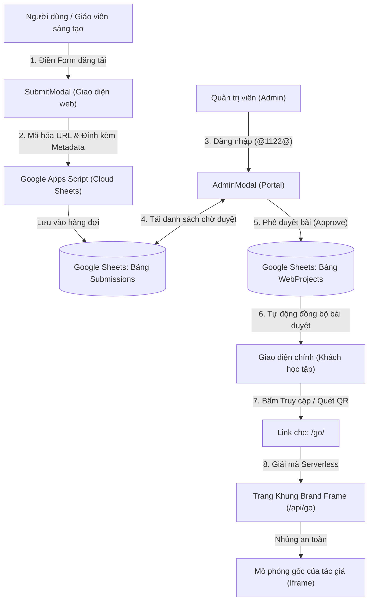

# TỔNG QUAN DỰ ÁN WEBSHARE-PMCA (WEBHUB SHOWCASE)
**Nền tảng Chia sẻ Mô phỏng Giáo dục, Thí nghiệm Ảo và Website Học tập Số**  
*Phiên bản tài liệu: 2026.10 • Cập nhật cùng Prompt Guide v24 & Chuẩn bảo mật mới*

---

## MỤC LỤC
1. [Giới thiệu chung & Thông tin dự án](#1-giới-thiệu-chung--thông-tin-dự-án)
2. [Bối cảnh & Vấn đề giải quyết](#2-bối-cảnh--vấn-đề-giải-quyết)
3. [Kiến trúc công nghệ & Mô hình dữ liệu](#3-kiến-trúc-công-nghệ--mô-hình-dữ-liệu)
4. [Các chức năng & Module cốt lõi](#4-các-chức-năng--module-cốt-lõi)
5. [Quy trình & Cách thức hoạt động](#5-quy-trình--cách-thức-hoạt-động)
6. [Bảo mật & Quyền riêng tư (Đặc biệt cho người dùng up bài)](#6-bảo-mật--quyền-riêng-tư-đặc-biệt-cho-người-dùng-up-bài)
7. [Hệ thống Cẩm nang AI & Đa ngôn ngữ Đông Nam Á](#7-hệ-thống-cẩm-nang-ai--đa-ngôn-ngữ-đông-nam-á)
8. [Hướng dẫn vận hành & Triển khai](#8-hướng-dẫn-vận-hành--triển-khai)

---

## 1. GIỚI THIỆU CHUNG & THÔNG TIN DỰ ÁN

* **Tên hệ thống:** WebHub Showcase (Webshare-PMCA / PMCA Show & Share)
* **Tên miền trực tuyến:** `https://webshare-pmca.vercel.app`
* **Mục tiêu cốt lõi:** Xây dựng một cổng thông tin tập trung, hiện đại, thân thiện và bảo mật cao, kết nối các sản phẩm mô phỏng học tập, thí nghiệm ảo, web giáo dục tương tác do giáo viên, học sinh và cộng đồng phát triển; đồng thời cung cấp thư viện mô phỏng kinh điển quốc tế và cẩm nang hướng dẫn tạo web bằng AI toàn diện.
* **Tác giả phát triển:** Lê Thanh Liêm
  * *Lĩnh vực:* Giáo dục · STEM · Công nghệ · Trí tuệ nhân tạo (AI)
  * *Địa bàn:* TP. Cần Thơ, Việt Nam
  * *Email:* `ltliem89@gmail.com` | `liemlt2@fe.edu.vn`
  * *Điện thoại / Zalo:* `0978152896`
* **Bản quyền & Giấy phép:** Bản quyền thiết kế, kiến trúc và giải thuật thuộc về tác giả. Mã nguồn được quản lý riêng tư (Private Repository) trên GitHub và triển khai liên tục qua Vercel.

---

## 2. BỐI CẢNH & VẤN ĐỀ GIẢI QUYẾT

### 2.1. Thực trạng thực tiễn
Trong kỷ nguyên bùng nổ của AI tạo sinh (Google AI Studio, Gemini, ChatGPT), giáo viên và học sinh phổ thông có thể nhanh chóng tạo ra các ứng dụng mô phỏng toán học, vật lý, hóa học, sinh học hoặc các bài giảng tương tác. Tuy nhiên, họ gặp phải hàng loạt rào cản lớn:
1. **Thiếu nơi lưu trữ và chia sẻ tập trung:** Các bài tập, trang web tạo ra thường nằm rải rác trên các link cá nhân, link Vercel tạm thời, không có kho lưu trữ có tổ chức để đồng nghiệp và học sinh toàn quốc dễ dàng tra cứu, học hỏi.
2. **Nỗi sợ lộ URL gốc và mã nguồn cá nhân:** Khi gửi link trực tiếp (như Vercel URL hay GitHub Pages), người tạo lo ngại bị sao chép ý tưởng, lộ tài khoản cá nhân, hoặc bị người khác can thiệp/phá hoại.
3. **Rào cản thiết bị trong lớp học:** Giáo viên muốn cho học sinh trải nghiệm mô phỏng ngay trên điện thoại hoặc máy tính bảng của các em trong giờ học nhưng việc gõ một đường link dài rất mất thời gian và dễ sai sót.
4. **Chi phí và hạ tầng phức tạp:** Việc duy trì một hệ thống có cơ sở dữ liệu lớn (SQL, máy chủ riêng) đòi hỏi chi phí bảo trì hàng tháng và nhân sự kỹ thuật quản trị.
5. **Rào cản ngôn ngữ khu vực:** Các nền tảng học tập thường chỉ hỗ trợ tiếng Anh hoặc tiếng Việt, thiếu sự kết nối với giáo viên và học sinh các nước láng giềng trong khu vực ASEAN.

### 2.2. Giải pháp của Webshare-PMCA
* Cung cấp giao diện trực quan với **Mockup trình duyệt thật**, phân loại khoa học theo môn học, cấp học và quốc gia.
* Xây dựng **Cơ chế Link che bảo vệ (`/go/<code>`)**, mã hóa URL gốc bằng thuật toán độc quyền, hiển thị bài nộp trong khung giao diện chuẩn mà không làm lộ URL thật.
* Tích hợp **Trình tạo mã QR tức thì** cho từng mô phỏng, quét camera là mở bài ngay trong tích tắc.
* Áp dụng kiến trúc **Serverless + Google Sheets Database** giúp hệ thống chạy mượt mà, lưu trữ dữ liệu vĩnh viễn, đồng bộ đa thiết bị mà hoàn toàn không tốn phí máy chủ.
* Tích hợp sẵn **SimBot Universal Prompt Guide v24** và hệ thống giao diện **10 ngôn ngữ Đông Nam Á**.

---

## 3. KIẾN TRÚC CÔNG NGHỆ & MÔ HÌNH DỮ LIỆU

### 3.1. Tech Stack (Ngăn xếp công nghệ)
| Thành phần | Công nghệ sử dụng | Vai trò trong hệ thống |
| :--- | :--- | :--- |
| **Giao diện (Frontend)** | React 19, TypeScript, Vite 6, Tailwind CSS v4 | Hiển thị giao diện siêu nhẹ, render nhanh, hỗ trợ đa thiết bị |
| **Icons & Hoạt ảnh** | Lucide React, Motion (Framer Motion v12) | Icon chuẩn UI hiện đại, hiệu ứng tương tác mượt mà |
| **Mã QR** | Thư viện `qrcode` | Sinh mã QR vector/canvas chất lượng cao tại chỗ (Client-side) |
| **Backend & Routing** | Vercel Serverless Function (`Node.js`) | Tiếp nhận route `/go/:code`, giải mã payload và render Brand Frame |
| **Lưu trữ Cục bộ** | `LocalStorage` (HTML5 Web Storage) | Lưu dữ liệu cache, tùy chọn ngôn ngữ, cấu hình lọc giúp web hoạt động cả khi offline |
| **Lưu trữ Đám mây** | Google Sheets + Google Apps Script Web App | Đóng vai trò Headless Database hai chiều: lưu bài nộp, lượt view, lượt like, đồng bộ đa thiết bị |
| **Bảo mật & Hosting** | GitHub (Private Repository) + Vercel Deployment | Bảo vệ mã nguồn tuyệt đối, triển khai tự động CI/CD (Zero Downtime) |

### 3.2. Mô hình Dữ liệu cốt lõi (`WebProject`)
Mỗi website mô phỏng trong hệ thống được quản lý qua một đối tượng TypeScript chuẩn hóa:
```typescript
export interface WebProject {
  id: string;               // Định danh duy nhất (vd: 'proj-phet', 'proj-user-1729...')
  title: string;            // Tiêu đề mô phỏng / website
  url: string;              // URL đích thực tế (được bảo vệ/giấu kín)
  description: string;      // Mô tả tóm tắt nội dung và điểm nổi bật
  country: CountryCode;     // Mã quốc gia (VN, GLOBAL, US, JP, SG...)
  category: CategoryId;     // Môn học (math, physics, chemistry, biology, stem...)
  educationLevel: EducationLevelId; // Cấp học (primary, secondary, highschool, university...)
  status: 'approved' | 'pending' | 'rejected'; // Trạng thái phê duyệt
  createdAt: string;        // Thời gian tạo định dạng ISO
  previewImage?: string;    // Ảnh thumbnail chụp màn hình hoặc mockup
  authorName: string;       // Tên tác giả / đơn vị đóng góp
  authorContact?: string;   // Kênh liên hệ (email/link - không bắt buộc)
  tags: string[];           // Danh sách từ khóa tìm kiếm
  views: number;            // Số lượt truy cập
  likes: number;            // Số lượt yêu thích từ cộng đồng
  goLink?: string;          // Link che an toàn dạng https://domain/go/<mã_hóa>
  isFamous?: boolean;       // Đánh dấu mô phỏng nổi tiếng quốc tế
  isUserSubmission?: boolean; // Đánh dấu bài do người dùng đóng góp
}
```

---

## 4. CÁC CHỨC NĂNG & MODULE CỐT LÕI

### 4.1. Khung Trình duyệt Giả lập (Browser Mockup Frame)
* **Vị trí:** [src/components/BrowserMockupFrame.tsx](file:///c:/Users/ltlie/Documents/GIT-DA/Webshare-PMCA/src/components/BrowserMockupFrame.tsx)
* **Chức năng:** 
  * Giả lập thanh địa chỉ trình duyệt với biểu tượng khóa bảo mật SSL (`Lock`), 3 nút cửa sổ (Mac style), và tên miền ảo hóa (`preview.web` hoặc domain nội bộ).
  * Hiển thị ảnh chụp màn hình thực tế của website thông qua cơ chế mshots timing thumbnail kết hợp link che `/go/<code>`, **không làm lộ domain gốc trong thẻ ``**.
  * Có nhãn nổi mang tên tác giả (`Author Badge`) ở góc dưới của ảnh chụp.
  * Tích hợp chỉ báo tải động (Loading spinner) khi hình ảnh đang được nạp, hỗ trợ `prefers-reduced-motion`.

### 4.2. Cơ chế Link che và Trang Khung Bảo vệ Bản quyền (`/go/<code>`)
* **Client Encoder:** [src/utils/goLink.ts](file:///c:/Users/ltlie/Documents/GIT-DA/Webshare-PMCA/src/utils/goLink.ts)
* **Serverless Frame:** [api/go/[code].ts](file:///c:/Users/ltlie/Documents/GIT-DA/Webshare-PMCA/api/go/%5Bcode%5D.ts)
* **Nguyên lý:**
  1. Khi một mô phỏng được duyệt hoặc hiển thị, hệ thống đóng gói JSON: `{ u: realUrl, t: title, a: authorName, e: authorEmail }`.
  2. Chuỗi này được mã hóa XOR đối xứng theo khóa bí mật `webhub-go-v2#sbx7q` rồi chuyển thành chuỗi `base64url`.
  3. Đường link chia sẻ cho người dùng sẽ là: `https://webshare-pmca.vercel.app/go/<mã_hóa>`.
  4. Khi truy cập link trên, Serverless Function của Vercel tiếp nhận, giải mã và trả về một **Trang Khung (Brand Frame)**:
     * Thanh địa chỉ trình duyệt **vẫn giữ nguyên `webshare-pmca.vercel.app/go/...`**, tuyệt đối không redirect 302 sang URL gốc.
     * Nạp ứng dụng thông qua thẻ `<iframe>` toàn màn hình.
     * Thanh công cụ phía trên hiển thị: Logo Học Tập Số, tên tác giả, nút liên hệ tác giả (nếu có), nút thu nhỏ khung, nút mở rộng toàn màn hình (`Fullscreen`), và nút "← Về trang chủ".

### 4.3. Hộp thoại Mã QR Tức thì (Instant QR Code Modal)
* **Vị trí:** [src/components/QRCodeModal.tsx](file:///c:/Users/ltlie/Documents/GIT-DA/Webshare-PMCA/src/components/QRCodeModal.tsx)
* **Chức năng:**
  * Tự động sinh mã QR độ nét cao từ đường link che `/go/<code>`.
  * Giáo viên có thể chiếu mã QR lên máy chiếu; học sinh chỉ cần mở camera điện thoại/máy tính bảng quét là có thể học và làm thí nghiệm ngay.
  * Hỗ trợ nút **"Tải mã QR"** (lưu ảnh PNG về máy) để in vào phiếu học tập hoặc chèn vào giáo án PowerPoint.
  * Hỗ trợ nút **"Sao chép link"** với thông báo trực quan.

### 4.4. Bộ Lọc Đa Chiều & Chế độ Xem Linh hoạt
* **Vị trí:** [src/components/FilterBar.tsx](file:///c:/Users/ltlie/Documents/GIT-DA/Webshare-PMCA/src/components/FilterBar.tsx)
* **2 Tab nội dung tách biệt rõ ràng:**
  1. **Tab "Bài đăng tải":** Tập hợp tất cả các mô phỏng do giáo viên, học sinh, chuyên gia trong cộng đồng sáng tạo và đóng góp.
  2. **Tab "Nổi tiếng":** Thư viện các nền tảng kinh điển quốc tế (PhET Colorado, GeoGebra, BioDigital Human, Wolfram, Desmos, Google Earth...).
* **Phân loại đa tầng:**
  * *12 Môn học:* Toán học, Vật lý, Hóa học, Sinh học, Tin học, Ngữ văn, Tiếng Anh, Lịch sử, Địa lý, KHTN, STEM, Môn khác.
  * *6 Cấp học:* Mọi cấp học, Tiểu học, THCS, THPT, Đại học, Nghề nghiệp.
  * *Quốc gia:* Hơn 20 quốc gia Đông Nam Á và đối tác quốc tế.
* **Chế độ xem:**
  * *Dạng Lưới (Expanded Grid):* Hiển thị đầy đủ Mockup, mô tả, môn học, tác giả, nút QR, nút truy cập.
  * *Dạng Rút gọn (Compact List):* Hiển thị bảng danh sách tinh gọn, tối ưu không gian hiển thị danh sách dài.

### 4.5. Cổng Quản trị Viên Toàn diện (Admin Portal)
* **Vị trí:** [src/components/AdminModal.tsx](file:///c:/Users/ltlie/Documents/GIT-DA/Webshare-PMCA/src/components/AdminModal.tsx)
* **Xác thực:** Đăng nhập bằng tài khoản Quản trị viên và mật khẩu bảo mật **`@1122@`**.
* **Công cụ quản lý:**
  * **Hàng đợi xét duyệt (Pending Approvals):** Xem bài mới người dùng gửi lên, thử nghiệm website, bấm Duyệt (`Approve`) để công khai hoặc Từ chối (`Reject`).
  * **Quản trị toàn bộ bài đăng:** Tìm kiếm, sửa đổi thông tin (đổi tên, link, môn học, cấp học, ảnh mockup) hoặc Xóa bài (`Delete`) với hộp thoại xác nhận tránh bấm nhầm.
  * **Sao lưu & Phục hồi:** Tải bản sao lưu cơ sở dữ liệu dạng `webhub-backup.json`, nhập dữ liệu JSON hoặc khôi phục dữ liệu mẫu ban đầu.
  * **Đồng bộ hóa đám mây:** Nút kéo dữ liệu bài chờ duyệt từ Google Sheets về để quản trị viên có thể kiểm duyệt trên bất kỳ thiết bị nào (điện thoại, laptop cá nhân).

---

## 5. QUY TRÌNH & CÁCH THỨC HOẠT ĐỘNG

### 5.1. Sơ đồ Luồng Hoạt động Tổng thể



### 5.2. Luồng nộp bài & Duyệt bài (Submission & Moderation Workflow)
1. **Bước 1 (Người dùng đóng góp):** Người dùng bấm *"Đăng tải website"*, nhập link mô phỏng (link Vercel, GitHub Pages, Netlify...), tên bài, mô tả, chọn môn, cấp học và tên tác giả.
2. **Bước 2 (Ghi nhận an toàn):** Hệ thống tạo bản ghi, tự động sinh mã link che `goLink`, gắn cờ `status: 'pending'`, lưu tạm vào LocalStorage và đẩy lên Google Sheets qua Apps Script.
3. **Bước 3 (Admin kiểm duyệt):** Quản trị viên đăng nhập vào Portal, kiểm tra tính sư phạm và an toàn của liên kết.
4. **Bước 4 (Công bố):** Khi admin bấm *Duyệt*, trạng thái chuyển thành `'approved'`, bài đăng xuất hiện ngay trong tab *"Bài đăng tải"* để học sinh và giáo viên cả nước truy cập.

### 5.3. Luồng truy cập mô phỏng của người học (Protected Experience Workflow)
1. Học sinh thấy bài mô phỏng trên bảng tin Webshare-PMCA.
2. Học sinh bấm **"Truy cập website"** hoặc quét **Mã QR**.
3. Trình duyệt mở đường dẫn: `https://webshare-pmca.vercel.app/go/<mã_hóa>`.
4. Màn hình hiện khung học tập số chuẩn:
   * Thanh trên cùng hiển thị: Tên bài, huy hiệu tác giả, nút phóng to màn hình, nút trở về trang chủ.
   * Khu vực nội dung hiển thị trọn vẹn mô phỏng học tập mượt mà, không quảng cáo, không chuyển hướng sang trang lạ.
   * Thanh địa chỉ **không bao giờ để lộ đường dẫn máy chủ backend hay link nội bộ của tác giả**.

---

## 6. BẢO MẬT & QUYỀN RIÊNG TƯ (ĐẶC BIỆT CHO NGƯỜI DÙNG UP BÀI)

Bảo vệ quyền lợi, bản quyền và an toàn thông tin cho người tham gia đóng góp là ưu tiên thiết kế hàng đầu của hệ thống:

### 6.1. Bảo vệ Tuyệt đối URL Gốc của Người Dùng (Source URL Masking)
* **Không lưu vết URL thật trên thanh địa chỉ:** Người dùng thông thường hoặc học sinh khi mở mô phỏng chỉ nhìn thấy URL của hệ thống (`webshare-pmca.vercel.app/go/...`). Ngay cả khi người dùng bấm copy link hoặc chia sẻ lên Facebook/Zalo, đường link được gửi đi vẫn là link che.
* **Không làm lộ URL thật trong mã nguồn trang (DOM Inspection Protection):** Thẻ `<a>` và các sự kiện click trên giao diện người dùng đều trỏ đến `goLink` thay vì URL gốc.
* **Che giấu URL thật trong ảnh thumbnail:** Dịch vụ tạo ảnh chụp mockup màn hình được gọi thông qua link `/go/<code>`, ngăn chặn việc soi mã nguồn thẻ `` để tìm link gốc.

### 6.2. Bảo vệ Quyền riêng tư & Danh tính Tác giả (Author Privacy)
* **Thông tin liên hệ là Tùy chọn (Optional):** Khi đăng bài, người dùng **không bắt buộc** phải điền email hay tài khoản mạng xã hội. Nếu người dùng muốn giữ kín danh tính, họ chỉ cần điền bút danh hoặc để trống kênh liên hệ.
* **Cơ chế ẩn email thông minh:** Trong trang khung `/go/<code>`, nếu tác giả có cung cấp email, email chỉ hiển thị đầy đủ trên màn hình rộng; trên màn hình nhỏ hoặc di động, email được giấu sau biểu tượng lá thư (`✉`) và chỉ mở trong cửa sổ popup khi người học chủ động nhấn vào để gửi phản hồi.

### 6.3. Kiểm duyệt Chống Mã Độc & Link Xấu (Anti-Abuse & Moderation)
* **Không công khai tự động:** Bất kỳ bài đăng mới nào từ cộng đồng đều phải đi qua hàng đợi xét duyệt `pending`. Điều này triệt tiêu hoàn toàn nguy cơ người xấu lợi dụng hệ thống để phát tán link lừa đảo, link độc hại, nội dung phản cảm hoặc spam.
* **Sandbox Iframe:** Trang khung nhúng mô phỏng với các thuộc tính bảo mật `allow="fullscreen; autoplay; geolocation"` và kiểm soát quyền truy cập, bảo vệ trình duyệt người học khỏi các tập lệnh can thiệp trái phép.

### 6.4. Bảo mật Quản trị & Hệ thống Mã nguồn
* **Mật khẩu Quản trị `@1122@`:** 
  * Xác thực trực tiếp, không hiển thị bất kỳ gợi ý mật khẩu nào trên form đăng nhập để chống tấn công đoán mật khẩu (Brute-force).
  * Phiên đăng nhập được quản lý an toàn trong phiên làm việc.
* **Kho lưu trữ GitHub Private:**
  * Toàn bộ mã nguồn dự án `Webshare-PMCA` được đặt ở chế độ **Private (Riêng tư)** trên GitHub. Người ngoài không thể truy cập, không thể xem code, không thể đọc được cấu trúc cơ sở dữ liệu hay thuật toán mã hóa của hệ thống.
  * Giao diện người dùng hoàn toàn không chứa bất kỳ liên kết nào trỏ về kho GitHub của website.
* **Khóa cố định Endpoint Google Apps Script:** URL kết nối cơ sở dữ liệu Google Sheets được cố định trong mã nguồn biên dịch, vô hiệu hóa hoàn toàn ô nhập URL script trên giao diện để tránh việc can thiệp trái phép vào luồng đồng bộ.

---

## 7. HỆ THỐNG CẨM NANG AI & ĐA NGÔN NGỮ ĐÔNG NAM Á

### 7.1. SimBot Universal Prompt Guide v24
Hệ thống tích hợp trực tiếp phiên bản mới nhất của cẩm nang sáng tạo mô phỏng [SIMBOT_UNIVERSAL_PROMPT_GUIDE_V24.md](file:///c:/Users/ltlie/Documents/GIT-DA/Webshare-PMCA/SIMBOT_UNIVERSAL_PROMPT_GUIDE_V24.md):
* **Quy trình 8 bước tiêu chuẩn:**
  1. *Lắng nghe nỗi đau học sinh:* Tìm ra khó khăn thực sự trong nhận thức của người học.
  2. *Thu thập kiến thức nguồn:* Cung cấp SGK, tài liệu chuẩn xác.
  3. *Tải cẩm nang Prompt Guide v24:* Sử dụng làm kim chỉ nam điều khiển AI.
  4. *Trao quyền cho AI:* Khởi động chế độ tự động hỏi đáp định hướng của SimBot.
  5. *Tạo app với AI Studio:* Lắp ráp giao diện, công thức, tương tác vật lý/toán học.
  6. *Kiểm thử trực tiếp:* Rà soát lỗi, độ chính xác khoa học và responsive di động.
  7. *Lưu trữ mã nguồn:* Hướng dẫn đẩy code lên GitHub.
  8. *Xuất bản trực tuyến:* Triển khai lên Vercel để nhận link web miễn phí.
* **Bổ sung mới của v24:** Tích hợp bộ quy chuẩn điều hướng không gian mô phỏng linh hoạt (Zoom, Pan, Fit-to-view, Reset-view, Fullscreen và tương tác đối tượng trực tiếp) cùng tiêu chuẩn Vercel Deploy Safety.
* **Nút tải & Xem nhanh:** Cho phép giáo viên tải file `.md` về máy chỉ với 1 click hoặc mở đọc trực tuyến ngay trong tab mới.

### 7.2. Hỗ trợ 10 Ngôn ngữ Đông Nam Á
Hệ thống dịch thuật hoàn chỉnh ([src/translations.ts](file:///c:/Users/ltlie/Documents/GIT-DA/Webshare-PMCA/src/translations.ts)) hỗ trợ người dùng chuyển đổi ngôn ngữ tức thì giữa 10 quốc gia trong khu vực:
* 🇻🇳 **Tiếng Việt (`vi`)**
* 🇺🇸 **English (`en`)** *(Singapore & Quốc tế)*
* 🇹🇭 **ไทย (`th`)** *(Thái Lan)*
* 🇲🇲 **မြန်မာ (`my`)** *(Myanmar)*
* 🇱🇦 **ລາວ (`lo`)** *(Lào)*
* 🇰🇭 **ខ្មែរ (`km`)** *(Campuchia)*
* 🇮🇩 **Bahasa Indonesia (`id`)** *(Indonesia)*
* 🇲🇾 **Bahasa Melayu (`ms`)** *(Malaysia & Brunei)*
* 🇵🇭 **Filipino (`tl`)** *(Philippines)*
* 🇹🇱 **Tetun (`tet`)** *(Đông Timor)*

Toàn bộ nhãn, thông báo, danh mục môn học, cấp học và hướng dẫn cẩm nang đều được địa phương hóa chuẩn xác.

---

## 8. HƯỚNG DẪN VẬN HÀNH & TRIỂN KHAI

### 8.1. Cài đặt Môi trường Phát triển (Local Dev)
1. Cài đặt Node.js (phiên bản khuyên dùng: 20+ hoặc 22+).
2. Di chuyển vào thư mục dự án và cài đặt dependencies:
   ```bash
   npm install
   ```
3. Khởi chạy máy chủ phát triển cục bộ:
   ```bash
   npm run dev
   ```
   *Website sẽ chạy tại: `http://localhost:3000`*

### 8.2. Kiểm tra Chất lượng Mã nguồn & Build Sản phẩm
* **Kiểm tra kiểu dữ liệu (TypeScript Typecheck):**
  ```bash
  npm run lint
  ```
* **Biên dịch bản phát hành (Production Build):**
  ```bash
  npm run build
  ```
  *(Kết quả được xuất ra thư mục `dist/`, kèm bản sao tự động của file cẩm nang v24).*

### 8.3. Triển khai Cập nhật lên Vercel
Nhờ hệ thống CI/CD tự động, mỗi khi có chỉnh sửa trong mã nguồn, bạn chỉ cần thực hiện 3 lệnh Git quen thuộc:
```bash
git add .
git commit -m "feat/fix: mô tả nội dung cập nhật"
git push origin main
```
Hệ thống Vercel sẽ tự động tiếp nhận từ nhánh `main` của Private Repo, thực hiện build và cập nhật website lên `https://webshare-pmca.vercel.app` trong khoảng 30 đến 60 giây.

---

## TỔNG KẾT

**Webshare-PMCA** không chỉ là một trang web tổng hợp liên kết, mà là một **Hệ sinh thái Giáo dục Số hoàn chỉnh và an toàn**:
* Giúp giáo viên tự tin sáng tạo và chia sẻ mà không sợ lộ mã nguồn hay URL gốc.
* Giúp học sinh tiếp cận kiến thức khoa học trực quan, sinh động qua một thao tác quét mã QR đơn giản.
* Kết nối tri thức giáo dục xuyên biên giới với chuẩn cẩm nang AI v24 và đa ngôn ngữ Đông Nam Á.
