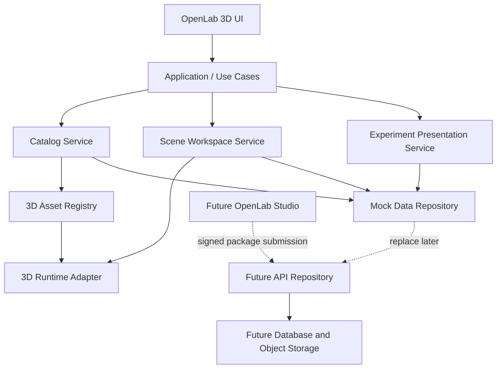
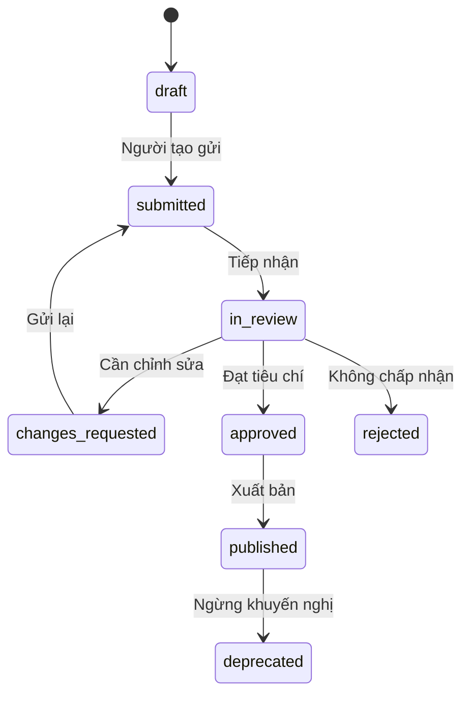

# OPENLAB 3D — MASTER SPECIFICATION
## Đặc tả sản phẩm, giao diện, kiến trúc module 3D và quản trị tài sản số

**Mã tài liệu:** OL3D-MASTER-SPEC  
**Phiên bản:** 1.0  
**Ngôn ngữ sản phẩm:** Tiếng Việt  
**Nền tảng mục tiêu:** Web desktop-first, đáp ứng màn hình nhỏ  
**Môi trường dựng prototype:** Google AI Studio — Build mode  
**Trạng thái:** Đặc tả định hướng; giai đoạn hiện tại chỉ dựng giao diện và mô phỏng tương tác bằng dữ liệu mẫu, chưa kết nối backend thật.

---

## 0. Đọc tài liệu này như thế nào

Tài liệu này có hai mục tiêu đồng thời:

1. Hướng dẫn công cụ AI tạo giao diện OpenLab 3D đủ rõ để người dùng có thể nhận xét và duyệt trước khi xây dựng luồng dữ liệu thật.
2. Đặt nền móng kiến trúc đủ ổn định để sau này thêm các thiết bị, bộ thiết bị, môi trường 3D, bài thí nghiệm và hành vi tương tác mà không phải viết lại ứng dụng từ đầu.

**Quy tắc quan trọng:** Phải thiết kế cho khả năng mở rộng ngay từ đầu, nhưng không triển khai quá sớm backend, đăng nhập thật, cơ sở dữ liệu, tải tệp lên máy chủ hoặc engine vật lý. Prototype cần thể hiện giao diện và các trạng thái bằng mock data; các lớp dữ liệu và hợp đồng module được khai báo trước để dễ chuyển sang triển khai thật sau khi giao diện được duyệt.

### Quy ước trong tài liệu

- **MUST / BẮT BUỘC:** yêu cầu không được bỏ qua.
- **SHOULD / NÊN:** khuyến nghị thiết kế mạnh; chỉ bỏ qua khi có lý do kỹ thuật.
- **MAY / CÓ THỂ:** tính năng tùy chọn hoặc thuộc giai đoạn sau.
- **Prototype:** bản thử nghiệm giao diện, dùng dữ liệu mẫu và chưa có backend thật.
- **Tài sản 3D (3D asset):** một mô hình/đối tượng 3D có tệp hình học và dữ liệu mô tả.
- **Thiết bị (equipment):** tài sản 3D đại diện cho một thiết bị hoặc vật mẫu trong thí nghiệm.
- **Bộ thiết bị (equipment kit):** một tập hợp có phiên bản của nhiều thiết bị được gom thành một nhóm theo mục đích.
- **Môi trường (environment):** cảnh hoặc căn phòng 3D có bố cục, ánh sáng, nền và khu vực thao tác.
- **Bài thí nghiệm (experiment):** mô tả mục tiêu, dụng cụ, các bước và cách ghi nhận kết quả; có thể sử dụng một hoặc nhiều thiết bị.
- **Mô-đun hành vi (behavior module):** mã ứng dụng đã được nhà phát triển kiểm soát để bổ sung tương tác có quy tắc cho một nhóm thiết bị; không phải mã tùy ý tải lên cùng mô hình.

---

# PHẦN I — TẦM NHÌN VÀ PHẠM VI

## 1. Tầm nhìn sản phẩm

OpenLab 3D là **thư viện trung tâm và không gian thực hành thí nghiệm 3D**. Hệ thống cho phép người dùng tìm kiếm, xem, lựa chọn và lắp ghép các thiết bị số đã được quản lý theo chuẩn chung, sau đó dùng chúng trong không gian phòng thí nghiệm và các bài thí nghiệm.

Trong định hướng dài hạn, OpenLab 3D kết nối với một môi trường riêng có tên làm việc là **OpenLab Studio**. Người học, giáo viên hoặc nhóm nghiên cứu tạo mô hình, đo đạc thiết bị thật, nhập hồ sơ dữ liệu, đóng gói và gửi đề xuất. Sau khi được kiểm duyệt, tài sản đủ điều kiện được đưa vào thư viện chính thức của OpenLab 3D.

### 1.1 Hai môi trường sản phẩm

**A. OpenLab 3D — Thư viện và môi trường chính thức**
- Quản lý các tài sản được chấp nhận.
- Cung cấp danh mục thiết bị, bộ thiết bị, môi trường và bài thí nghiệm.
- Cho phép bố trí thiết bị trong phòng 3D và xem thông số.
- Quản lý phiên bản chính thức và trạng thái xác minh.
- Là nơi người dùng tìm kiếm và tái sử dụng tài sản đã được phê duyệt.

**B. OpenLab Studio — Môi trường tạo tài sản, thuộc giai đoạn sau**
- Tạo hoặc nhập mô hình 3D.
- Nhập số đo, ảnh thiết bị thật, nguồn dữ liệu và thông số.
- Tổ chức các thiết bị thành một bộ.
- Kiểm tra định dạng và chất lượng trước khi gửi.
- Theo dõi phản hồi kiểm duyệt.
- Không có quyền tự xuất bản trực tiếp vào thư viện chính thức trừ khi được cấp quyền rõ ràng.

**Biên tích hợp:** Studio gửi một gói tài sản theo chuẩn; OpenLab 3D tiếp nhận, kiểm tra, duyệt và phát hành một phiên bản chính thức. Hai môi trường không dùng chung trạng thái làm việc chưa hoàn tất.

## 2. Mục tiêu của phiên bản giao diện đầu tiên

Prototype hiện tại cần:

1. Thể hiện được giao diện trung tâm OpenLab 3D theo phương án đã chọn.
2. Hiển thị thư viện thiết bị, không gian phòng thí nghiệm, thông tin thiết bị, bước thí nghiệm, bảng kết quả và lựa chọn môi trường.
3. Cho phép tương tác UI cơ bản: tìm kiếm, lọc, chọn thiết bị, thêm thiết bị vào phòng, chuyển bước, chọn môi trường, bật/tắt lớp thông tin.
4. Dùng dữ liệu mẫu được tách khỏi component.
5. Có cấu trúc mã nguồn theo module, không phụ thuộc một tệp component khổng lồ.
6. Thiết kế sẵn hợp đồng dữ liệu để sau này thay mock repository bằng API/database mà không thay đổi phần lớn giao diện.
7. Chuẩn bị kiến trúc nạp mô hình GLB/glTF và fallback nếu tệp không tải được.
8. Phân biệt rõ nội dung minh họa với dữ liệu đo lường đã được kiểm chứng.

## 3. Ngoài phạm vi prototype

Không triển khai ở giai đoạn hiện tại:
- Xác thực người dùng thật và phân quyền phía máy chủ.
- Cơ sở dữ liệu thật.
- Tải mô hình lên kho lưu trữ từ trình duyệt.
- Luồng gửi, duyệt và xuất bản thật.
- Đồng bộ hai chiều với OpenLab Studio.
- Hệ thống thanh toán, gamification hoặc điểm thành tích.
- Mô phỏng vật lý chính xác, cơ học chất lỏng, tương tác điện/quang hoàn chỉnh.
- Tự động xác minh độ chính xác khoa học chỉ bằng hình dạng 3D.
- Cho phép tệp người dùng thực thi JavaScript hoặc WebAssembly tùy ý.

Các mục trên là khả năng tương lai và cần được thiết kế, kiểm thử riêng ở giai đoạn tiếp theo.

---

# PHẦN II — NGUYÊN TẮC KIẾN TRÚC

## 4. Bốn lớp không được nhập làm một

Để thêm module về sau thuận lợi, mọi thiết bị phải được xem là sự kết hợp có cấu trúc của bốn lớp độc lập.

### Lớp 1 — Hình học và hiển thị (Geometry / Presentation)
Chứa:
- Tệp mô hình 3D GLB/glTF.
- Thumbnail, ảnh thật và hình minh họa.
- Điểm gốc (origin/anchor), kích thước bao (bounding box), hướng mặc định.
- Vật liệu, texture và các node được đặt tên có quy ước.
- Thông tin tối ưu hóa và giới hạn hiển thị.

Lớp này trả lời câu hỏi: **Thiết bị trông như thế nào và được đặt trong không gian ra sao?**

### Lớp 2 — Hồ sơ khoa học và kỹ thuật (Scientific / Technical Metadata)
Chứa:
- Tên, mã thiết bị, nhóm, nhà sản xuất nếu biết.
- Kích thước và đơn vị.
- Khối lượng tham chiếu, vật liệu, dung tích, giới hạn đo, độ chia nhỏ nhất.
- Phương pháp đo, dụng cụ tham chiếu, ngày thu thập dữ liệu.
- Nguồn dữ liệu, độ không đảm bảo đo hoặc sai lệch khi đã xác định.
- Trạng thái kiểm chứng và phạm vi kiểm chứng.

Lớp này trả lời câu hỏi: **Thiết bị có các đặc tính nào và dữ liệu đó đáng tin cậy đến đâu?**

### Lớp 3 — Hành vi và khả năng tương tác (Behavior / Capabilities)
Chứa các khả năng được hệ thống cho phép, ví dụ:
- `selectable`: có thể chọn.
- `translatable`: có thể di chuyển.
- `rotatable`: có thể xoay.
- `scalableViewOnly`: được phép đổi kích thước hiển thị nhưng không thay đổi kích thước vật lý thực.
- `showDimensions`: hiển thị kích thước.
- `readScale`: có khả năng đọc vạch chia theo một quy tắc.
- `weighObject`: có hành vi cân khi được engine đo lường hỗ trợ.
- `displacementVolume`: hỗ trợ quy trình dời chỗ nếu module đo lường tương ứng được triển khai.

Chỉ khai báo capability trong manifest không có nghĩa là phép đo đã được mô phỏng thật. Mỗi capability phải nêu rõ trạng thái thực thi: `ui-demo`, `implemented` hoặc `validated`.

Lớp này trả lời câu hỏi: **Người dùng có thể làm gì với thiết bị và quy tắc nào điều khiển việc đó?**

### Lớp 4 — Phiên bản và bố trí trong phòng (Instance / Scene Placement)
Chứa:
- Tham chiếu tới mã tài sản và phiên bản cụ thể.
- Vị trí, góc xoay và hệ số hiển thị trong một cảnh.
- Trạng thái đang chọn, ẩn/hiện hoặc cấu hình riêng của lần thực hành.
- Liên kết tới bài thí nghiệm đang sử dụng.

Lớp này trả lời câu hỏi: **Phiên bản thiết bị nào đang được đặt ở đâu trong cảnh cụ thể?**

**BẮT BUỘC:** Không lưu tọa độ đặt trong phòng vào hồ sơ tài sản gốc. Một thiết bị có thể được đặt ở nhiều vị trí trong nhiều phòng khác nhau mà không tạo ra bản sao tài sản.

## 5. Kiến trúc logic tổng thể



### 5.1 Nguyên tắc phụ thuộc
- UI component không được gọi trực tiếp database hoặc dịch vụ lưu trữ.
- UI nhận dữ liệu từ hook/service hoặc repository interface.
- Repository hiện tại dùng mock data; tương lai có thể thay bằng API repository.
- Module 3D không được gắn cứng vào một màn hình cụ thể.
- Thông tin tài sản không được nhúng trùng lặp trong nhiều component.
- Hành vi tùy chỉnh phải đăng ký qua registry hoặc danh sách capability được kiểm soát.
- Tệp dữ liệu không được quyết định import và chạy mã thực thi tùy ý.

## 6. Các miền nghiệp vụ (domain boundaries)

Tổ chức code và dữ liệu theo những miền sau:

1. **Catalog:** thiết bị, phiên bản, danh mục, tag, trạng thái xuất bản.
2. **Asset Package:** manifest, mô hình, ảnh, tài liệu nguồn và checksum.
3. **Scene Workspace:** cảnh, instance thiết bị, transform và trạng thái UI của cảnh.
4. **Environment:** mẫu phòng, bàn thí nghiệm, ánh sáng, camera và điểm đặt.
5. **Experiment:** mục tiêu, danh sách dụng cụ, trình tự bước, bảng kết quả và công thức minh họa.
6. **Validation:** kiểm tra tệp, kiểm tra hình học, kiểm tra số liệu và kiểm chứng khoa học.
7. **Governance:** quyền sở hữu, giấy phép, kiểm duyệt, sự kiện kiểm toán và phiên bản.
8. **Studio Integration (future):** gói đề xuất, người gửi, trạng thái xét duyệt và phản hồi.

Không gom mọi thứ vào đối tượng chung tên `data` hoặc `model`. Mỗi miền cần kiểu dữ liệu và trách nhiệm riêng.

---

# PHẦN III — THIẾT KẾ GIAO DIỆN

## 7. Bố cục desktop chính

Thiết kế mục tiêu ở độ phân giải 1536 × 1024. Bố cục cần co giãn theo chiều rộng và không được vỡ ở laptop.

### 7.1 Thanh điều hướng trên cùng
Hiển thị:
- Logo OpenLab 3D.
- Thư viện thiết bị.
- Phòng thí nghiệm 3D.
- Bài thí nghiệm.
- Cộng đồng.
- Hướng dẫn.
- Tìm kiếm toàn cục.
- Thông báo demo.
- Hồ sơ người dùng mẫu, có nhãn vai trò.

Các mục chưa có trang thật phải mở trang placeholder hợp lệ; không được dẫn tới liên kết hỏng.

### 7.2 Cột trái — thư viện tài sản
Tab:
- Thiết bị.
- Bộ thiết bị.
- Môi trường.

Bộ lọc:
- Tất cả.
- Đo khối lượng.
- Đo thể tích.
- Đo lực.
- Đo kích thước.
- Dụng cụ thủy tinh.
- Vật mẫu.
- Thiết bị điện.
- Thiết bị quang.
- Hóa học.
- Sinh học.

Thẻ thiết bị phải thể hiện:
- Ảnh thumbnail.
- Tên.
- Mã hoặc loại.
- Trạng thái chất lượng bằng nhãn và màu nhất quán.
- Nút chọn/thêm nếu phù hợp.

Danh sách ban đầu cần có tối thiểu: cân điện tử, ống đong 100 ml, cốc thủy tinh 250 ml, bình tràn, lực kế, thước cặp, quả cân 50 g, vật rắn hình trụ, vật rắn hình cầu, vật rắn hình hộp, bình tam giác và giá đỡ.

### 7.3 Khu vực trung tâm — workspace 3D
Đây là vùng có mức ưu tiên cao nhất.

Phần trên của workspace:
- Tên không gian: “Không gian thí nghiệm 3D”.
- Tên cảnh/bài thí nghiệm đang mở.
- Chế độ Thực hành / Thiết kế (chỉ trạng thái UI ở prototype).
- Các nút Mới, Mở, Lưu, Chia sẻ, Chạy thí nghiệm; những chức năng chưa có thật phải được gắn trạng thái demo hoặc “Sắp triển khai”.

Thanh công cụ trong workspace:
- Chọn.
- Di chuyển.
- Xoay.
- Phóng to/thu nhỏ.
- Hiện/ẩn lưới.
- Hiện/ẩn nhãn.
- Hiện/ẩn kích thước.
- Chụp ảnh.
- Đặt lại camera.

Scene demo:
- Phòng thí nghiệm khoa học, bàn thí nghiệm rõ ràng.
- Thiết bị của thí nghiệm đo khối lượng riêng: cân, ống đong, bình tràn/cốc nước, vật rắn, giá đỡ/lực kế nếu phù hợp.
- Các thiết bị có thể được chọn trực quan; thiết bị được chọn có đường viền/nhãn rõ.
- Hiện trạng tải mô hình, lỗi tải và empty state.

Nếu dựng Three.js ngay trong prototype, dùng loader/component riêng; nếu chưa có tệp GLB thật, dùng primitive hoặc mô hình mẫu. Không biến một hình ảnh nền tĩnh thành “mô phỏng 3D hoạt động”. Khi chỉ là preview, phải giữ trải nghiệm đẹp nhưng không tuyên bố có phép đo thực.

### 7.4 Cột phải — thông tin thiết bị đang chọn
Tab:
- Thông tin.
- Mô hình 3D.
- Dữ liệu đo.
- Hướng dẫn.

Các trường có thể hiển thị:
- Tên thiết bị, mã tài sản, phiên bản.
- Trạng thái phát hành.
- Mức độ kiểm chứng.
- Dung tích / giới hạn đo / độ chia nhỏ nhất.
- Kích thước ngoài, chiều cao, đường kính.
- Khối lượng tham chiếu.
- Vật liệu.
- Phương pháp đo và nguồn dữ liệu.
- Lịch sử cập nhật ở dạng xem demo.

Tùy chọn hiển thị có thể bật/tắt:
- Hiện tên.
- Hiện nhãn.
- Hiện kích thước.
- Hiện hệ trục / lưới.
- Hiện hướng dẫn thao tác.

Không dùng số liệu chính xác giả tạo để tạo cảm giác đã hiệu chuẩn. Mock data phải có nhãn `DỮ LIỆU MINH HỌA` khi số đo chưa được xác thực.

### 7.5 Khu vực dưới workspace
Tổ chức thành các panel/tab có thể thu gọn:

**A. Quy trình thí nghiệm**
1. Chuẩn bị dụng cụ và vật mẫu.
2. Đo khối lượng.
3. Đo thể tích.
4. Tính khối lượng riêng.
5. Ghi kết quả và nhận xét.

Mỗi bước có tên, mô tả, trạng thái và nội dung chi tiết. Nút Bước trước/Bước tiếp hoạt động bằng state cục bộ.

**B. Kết quả minh họa**
Bảng có các cột: Đại lượng, ký hiệu, giá trị, đơn vị, trạng thái/ghi chú. Nếu dùng công thức `V = V2 - V1` hoặc `rho = m/V`, cần kiểm tra đơn vị và giá trị nhất quán. Gắn nhãn dữ liệu demo.

**C. Môi trường thí nghiệm**
Các thẻ chọn môi trường:
- Phòng thí nghiệm Vật lí.
- Phòng thí nghiệm Hóa học.
- Phòng thí nghiệm Sinh học.
- Bàn thí nghiệm cơ bản.
- Phòng học STEM.
- Môi trường ngoài trời.

Việc chọn thẻ phải thay đổi trạng thái và vùng preview tương ứng; cảnh thực có thể được tích hợp theo giai đoạn.

## 8. Điều hướng và phản hồi UI

### 8.1 Hành vi tối thiểu phải chạy
- Tìm kiếm lọc thiết bị theo tên, mã, tag.
- Chọn danh mục lọc đúng danh sách.
- Chọn thẻ thiết bị cập nhật panel thông tin.
- Thêm thiết bị tạo một instance trong cảnh.
- Chọn instance trong cảnh đồng bộ với panel thiết bị.
- Xóa instance khỏi cảnh (có xác nhận hoặc undo demo).
- Di chuyển/xoay instance nếu 3D runtime hỗ trợ; nếu chưa hỗ trợ, nút phải phản hồi và giải thích giới hạn.
- Chuyển bước thí nghiệm.
- Chọn môi trường.
- Bật/tắt lớp thông tin.
- Đặt lại cảnh về trạng thái ban đầu.
- Nút chức năng tương lai mở thông báo “Chức năng này sẽ được triển khai ở giai đoạn sau”.

### 8.2 States
Mỗi component tương tác nên xác định tối thiểu các trạng thái:
- Default.
- Hover.
- Selected.
- Disabled.
- Loading.
- Empty.
- Error.
- Success/confirmation.

### 8.3 Responsive
- Desktop: ba cột chính và vùng nội dung dưới.
- Tablet: thư viện và panel thiết bị có thể thu gọn.
- Mobile: không bắt buộc chỉnh sửa cảnh 3D đầy đủ; ưu tiên xem tài sản, thông số và bước thí nghiệm. Không làm giao diện vỡ nếu chiều rộng nhỏ.

---

# PHẦN IV — HỆ THỐNG ĐỊNH DANH VÀ PHIÊN BẢN

## 9. Mã định danh bất biến

Tên hiển thị có thể thay đổi; ID nội bộ không được thay đổi khi sửa tên, thumbnail hay thông số.

Định dạng mã dễ đọc đề xuất:
- Thiết bị: `OL3D-EQP-CYL-0001`.
- Bộ thiết bị: `OL3D-KIT-DENSITY-0001`.
- Môi trường: `OL3D-ENV-PHYSICS-0001`.
- Bài thí nghiệm: `OL3D-EXP-DENSITY-SOLID-0001`.
- Gói gửi duyệt: `OL3D-SUB-2026-000001`.

Trong hệ thống thực, mỗi tài sản nên có UUID/ULID làm khóa chính kỹ thuật. Mã dễ đọc phía trên là mã hiển thị có thể sinh tự động. Không dùng tên tệp hoặc tên thiết bị làm khóa chính.

## 10. Những phiên bản cần tách riêng

Không dùng một trường `version` duy nhất cho tất cả.

1. `assetVersion`: phiên bản tài sản do người quản lý phát hành, ví dụ `1.0.0`.
2. `manifestSchemaVersion`: phiên bản cấu trúc JSON, ví dụ `1.0.0`.
3. `moduleApiVersion`: phiên bản hợp đồng capability/behavior mà runtime hỗ trợ.
4. `modelFileVersion`: phiên bản tệp hình học nếu thay đổi độc lập.
5. `experimentVersion`: phiên bản bài thí nghiệm.
6. `sceneRevision`: số lần cập nhật bố trí cảnh.

### 10.1 Quy tắc SemVer
- **MAJOR:** thay đổi gây mất tương thích với scene/bundle đang dùng hoặc thay đổi cấu trúc cần migration.
- **MINOR:** thêm trường tùy chọn/capability mới nhưng tương thích ngược.
- **PATCH:** sửa lỗi metadata, thumbnail hoặc tối ưu mô hình không làm thay đổi hành vi/cách dùng.

Không ghi đè tệp của phiên bản đã xuất bản. Tạo phiên bản mới và giữ phiên bản cũ để các cảnh cũ có thể tái tạo được.

---

# PHẦN V — HỢP ĐỒNG TÀI SẢN 3D VÀ MODULE MỞ RỘNG

## 11. Định dạng asset chính

### 11.1 Định dạng ưu tiên
- **GLB (`.glb`):** ưu tiên cho một gói mô hình đơn lẻ vì thường đóng gói hình học, vật liệu và texture trong một tệp.
- **glTF (`.gltf`):** hỗ trợ khi cần tách JSON, binary và texture thành nhiều tệp.
- Ảnh: PNG/JPEG/WebP tùy trường hợp.
- Metadata: JSON theo schema có version.
- Tài liệu nguồn: PDF/Markdown/ảnh, nếu cần và nếu có quyền sử dụng.

glTF/GLB là định dạng truyền tải tài sản 3D; bản thân tệp không định nghĩa đầy đủ các quy tắc đo lường, hiệu chuẩn hoặc phép tính khoa học của thiết bị.

### 11.2 Quy ước không gian
- Đơn vị nội bộ của cảnh: mét (m).
- Quy đổi sang mm, cm, ml, g ở lớp hiển thị/metadata theo trường hợp.
- Tọa độ hệ thống: Y-up hoặc quy ước được chọn thống nhất và ghi trong manifest. Nếu dùng Three.js, dự án phải xác định rõ hệ quy chiếu trong adapter và xử lý tệp nhập có trục khác.
- Không được thay đổi kích thước vật lý thật khi người dùng chỉ phóng to/thu nhỏ camera.
- `displayScale` chỉ dùng khi có chủ đích thị giác và phải hiển thị rõ rằng tỷ lệ đang không phải kích thước thực.
- Điểm gốc/pivot phải nhất quán; thiết bị cần có `anchor` hoặc quy tắc pivot mặc định để đặt lên mặt bàn dễ dàng.

### 11.3 Quy tắc tên node trong mô hình
Khi cần các phần tử bên trong mô hình để gắn nhãn/hoạt động, đặt tên ổn định, ví dụ:
- `root`
- `body`
- `scale_display`
- `scale_marks`
- `liquid_surface`
- `plunger`
- `handle`
- `measurement_anchor`

Node không bắt buộc phải có đủ tên nếu mô hình chỉ để quan sát. Tuy nhiên, mọi node được tham chiếu bởi hành vi phải có tên ổn định; không phụ thuộc vào chỉ số node theo vị trí trong mảng.

## 12. Cấu trúc gói thiết bị

Gói tiêu chuẩn đề xuất:

```text
OL3D-EQP-CYL-0001__v1.0.0/
├── manifest.json
├── model/
│   └── model.glb
├── preview/
│   ├── thumbnail.webp
│   ├── front.png
│   └── real-equipment.jpg
├── documentation/
│   ├── measurement-method.md
│   └── notes.md
├── validation/
│   ├── geometry-report.json
│   └── measurement-report.json
└── LICENSE.txt
```

Không phải tất cả tệp đều bắt buộc ở mọi cấp kiểm chứng. Manifest phải nêu rõ tệp nào có và trạng thái nào chưa có.

## 13. Manifest thiết bị — ví dụ định hướng

Đây là ví dụ schema ở mức thiết kế, không phải dữ liệu đã được xác minh khoa học:

```json
{
  "manifestSchemaVersion": "1.0.0",
  "assetId": "OL3D-EQP-CYL-0001",
  "assetVersion": "1.0.0",
  "kind": "equipment",
  "slug": "ong-dong-100-ml",
  "name": {
    "vi": "Ống đong 100 ml",
    "en": "100 ml Graduated Cylinder"
  },
  "summary": "Mô hình thiết bị đo thể tích chất lỏng.",
  "categories": ["laboratory-glassware", "volume-measurement"],
  "tags": ["ong-dong", "the-tich", "khtn"],
  "files": {
    "model": "model/model.glb",
    "thumbnail": "preview/thumbnail.webp",
    "realPhotos": ["preview/real-equipment.jpg"]
  },
  "units": {
    "sceneLength": "m",
    "metadataPreferredLength": "mm",
    "mass": "g",
    "volume": "ml"
  },
  "geometry": {
    "upAxis": "Y",
    "anchor": "base-center",
    "dimensions": {
      "height": {"value": 0.25, "unit": "m", "status": "illustrative"},
      "outerDiameter": {"value": 0.032, "unit": "m", "status": "illustrative"}
    },
    "scaleValidation": "not-verified"
  },
  "scientificProperties": {
    "capacity": {"value": 100, "unit": "ml", "status": "illustrative"},
    "leastCount": {"value": 1, "unit": "ml", "status": "illustrative"},
    "material": {"value": "glass", "status": "reported"}
  },
  "capabilities": [
    {"id": "selectable", "state": "implemented"},
    {"id": "translatable", "state": "ui-demo"},
    {"id": "showDimensions", "state": "ui-demo"},
    {"id": "readScale", "state": "not-implemented"}
  ],
  "validation": {
    "assetReviewStatus": "draft",
    "geometryStatus": "not-verified",
    "metrologyStatus": "not-verified",
    "behaviorStatus": "not-implemented",
    "safetyStatus": "not-reviewed"
  },
  "provenance": {
    "createdBy": "demo-user-001",
    "sourceType": "sample-data",
    "measurementMethod": null,
    "measurementDate": null
  },
  "rights": {
    "licenseId": "internal-demo",
    "redistributionAllowed": false
  },
  "runtimeRequirements": {
    "moduleApiVersion": "1.x",
    "minimumViewerVersion": "0.1.0"
  }
}
```

**Lưu ý quan trọng:** Các số trong ví dụ chỉ nhằm minh họa cấu trúc và phải gắn trạng thái `illustrative`. Không dùng số liệu này làm kết quả khoa học.

### 13.1 Trường bắt buộc trong manifest
- schema version.
- asset ID, asset version, kind, name.
- đường dẫn mô hình hoặc placeholder rõ trạng thái.
- định nghĩa đơn vị/hệ trục.
- trạng thái kiểm duyệt và xác minh.
- thông tin quyền sử dụng.
- nguồn gốc tối thiểu.

### 13.2 Trường khuyến nghị
- tên đa ngôn ngữ.
- category, tags, summary.
- ảnh thiết bị thật.
- phương pháp đo và người/nhóm đo.
- thông số hình học có sai số/độ không đảm bảo nếu có.
- capabilities.
- ghi chú tương thích.
- checksum của tệp.

## 14. Module 3D và registry — thêm thiết bị mới mà không sửa lõi

**Nguyên tắc:** Thêm một mô hình 3D mới không được đòi hỏi chỉnh sửa component giao diện chính. Giao diện đọc asset từ registry/repository và render dựa trên trường `kind`, `files`, `capabilities` và dữ liệu mô tả.

### 14.1 Ba kiểu mở rộng

**Kiểu A — Asset tĩnh**
- Chỉ có mô hình, ảnh và metadata.
- Dùng để quan sát, chọn, di chuyển và bố trí.
- Không có hành vi khoa học chuyên biệt.

**Kiểu B — Asset có capability chuẩn**
- Dùng các hành vi dựng sẵn như chọn, di chuyển, xoay, hiện kích thước, hiện nhãn.
- Chỉ cần khai báo capability trong manifest.
- Không cần viết module mới nếu capability đã được runtime hỗ trợ.

**Kiểu C — Asset cần behavior module chuyên biệt**
- Ví dụ cân điện tử, lực kế, ống đong có đọc mực chất lỏng, thấu kính có tia sáng.
- Hành vi được viết bởi nhóm phát triển và đăng ký vào một danh mục module được duyệt.
- Manifest chỉ tham chiếu `behaviorModuleId` và cấu hình được phép; manifest không chứa mã executable tùy ý.
- Khi module chưa được cài/đăng ký, mô hình vẫn tải được ở chế độ quan sát với cảnh báo “Chưa có mô-đun tương tác”.

### 14.2 Mẫu cấu trúc code đề xuất

```text
src/
├── app/
│   ├── App.tsx
│   ├── routes.tsx
│   └── providers/
├── components/
│   ├── layout/
│   ├── navigation/
│   ├── common/
│   └── feedback/
├── features/
│   ├── catalog/
│   │   ├── components/
│   │   ├── hooks/
│   │   └── services/
│   ├── lab-workspace/
│   │   ├── components/
│   │   ├── hooks/
│   │   └── services/
│   ├── equipment-details/
│   ├── experiment-panel/
│   ├── results-panel/
│   └── environment-selector/
├── domain/
│   ├── equipment/
│   │   ├── types.ts
│   │   ├── schema.ts
│   │   └── capabilities.ts
│   ├── kit/
│   ├── environment/
│   ├── experiment/
│   └── scene/
├── three-runtime/
│   ├── LabCanvas.tsx
│   ├── AssetLoader.ts
│   ├── AssetRegistry.ts
│   ├── SelectionController.ts
│   ├── TransformController.ts
│   └── adapters/
├── repositories/
│   ├── EquipmentRepository.ts
│   ├── SceneRepository.ts
│   └── ExperimentRepository.ts
├── data/
│   ├── mock-equipment.ts
│   ├── mock-kits.ts
│   ├── mock-environments.ts
│   ├── mock-experiments.ts
│   └── mock-scenes.ts
├── styles/
└── utils/
```

Có thể điều chỉnh tên thư mục theo cấu hình dự án AI Studio, nhưng phải giữ nguyên nguyên tắc tách miền và trách nhiệm.

### 14.3 Hợp đồng asset loader

Asset loader phải cung cấp giao diện ổn định kiểu:

```ts
export interface AssetLoadResult {
  assetId: string;
  assetVersion: string;
  root: unknown; // chuyển thành THREE.Object3D trong implementation Three.js
  warnings: string[];
}

export interface AssetLoader {
  load(asset: EquipmentAsset): Promise<AssetLoadResult>;
  validate(asset: EquipmentAsset): Promise<AssetValidationSummary>;
  dispose(assetId: string, assetVersion: string): void;
}
```

Trong code Three.js thật, thay `unknown` bằng kiểu `THREE.Object3D` hoặc kiểu cụ thể tương ứng. Ví dụ trên chỉ xác định hợp đồng, không thay thế việc kiểm tra kiểu khi triển khai.

### 14.4 Hợp đồng capability

```ts
export type CapabilityState =
  | "ui-demo"
  | "implemented"
  | "validated"
  | "not-implemented";

export interface EquipmentCapability {
  id: string;
  state: CapabilityState;
  config?: Record<string, string | number | boolean>;
}

export interface BehaviorModuleDescriptor {
  id: string;
  version: string;
  moduleApiVersion: string;
  supportedAssetKinds: string[];
  supportedCapabilities: string[];
  safetyLevel: "visual-only" | "interactive" | "measurement";
}
```

**Bảo mật:** Không cho phép các file tải lên cung cấp trực tiếp `importPath`, URL JavaScript tùy ý hoặc một hàm thực thi. Chỉ các module đã được đóng gói cùng ứng dụng và được nhà phát triển cho phép mới có thể chạy.

### 14.5 Registry mẫu

```ts
export const behaviorRegistry = {
  "basic-transform": BasicTransformBehavior,
  "scale-display-demo": ScaleDisplayDemoBehavior,
  "graduated-cylinder-demo": GraduatedCylinderDemoBehavior,
};
```

Registry trong prototype chỉ chứa module demo đã khai báo trong code. Về sau có thể thêm module mới bằng cách:
1. Tạo module theo interface chuẩn.
2. Viết test.
3. Đăng ký module vào registry.
4. Khai báo capability tương ứng trong asset manifest.
5. Đánh version và ghi yêu cầu runtime.

Không cần sửa toàn bộ màn hình hoặc dữ liệu các thiết bị khác.

---

# PHẦN VI — CÁC MÔ HÌNH DỮ LIỆU CHÍNH

## 15. Kiểu dữ liệu TypeScript định hướng

Các kiểu sau là khung để dùng trong frontend. Có thể bổ sung field, nhưng không nên đổi nghĩa field mà không tăng version schema.

```ts
export type PublicationStatus =
  | "draft"
  | "submitted"
  | "in-review"
  | "changes-requested"
  | "approved"
  | "published"
  | "rejected"
  | "deprecated";

export type VerificationStatus =
  | "not-verified"
  | "partially-verified"
  | "verified"
  | "failed";

export interface QuantityValue {
  value: number;
  unit: string;
  uncertainty?: number;
  uncertaintyUnit?: string;
  status: "illustrative" | "reported" | "measured" | "verified";
  methodRef?: string;
  measuredAt?: string;
}

export interface EquipmentAsset {
  assetId: string;
  assetVersion: string;
  schemaVersion: string;
  kind: "equipment";
  slug: string;
  name: Record<string, string>;
  summary?: string;
  categoryIds: string[];
  tags: string[];
  thumbnailUrl?: string;
  modelUrl?: string;
  realPhotoUrls?: string[];
  dimensions?: Record<string, QuantityValue>;
  mass?: QuantityValue;
  material?: string;
  capabilities: EquipmentCapability[];
  publicationStatus: PublicationStatus;
  geometryStatus: VerificationStatus;
  metrologyStatus: VerificationStatus;
  behaviorStatus: VerificationStatus;
  rightsId: string;
  sourceRecordId?: string;
}

export interface EquipmentInstance {
  instanceId: string;
  assetId: string;
  assetVersion: string;
  transform: {
    positionM: [number, number, number];
    rotationRad: [number, number, number];
    displayScale: [number, number, number];
  };
  visible: boolean;
  labelVisible: boolean;
  config?: Record<string, string | number | boolean>;
}

export interface LabScene {
  sceneId: string;
  sceneRevision: number;
  name: string;
  environmentId: string;
  equipmentInstances: EquipmentInstance[];
  camera?: {
    position: [number, number, number];
    target: [number, number, number];
  };
  createdAt: string;
  updatedAt: string;
}
```

### 15.1 Quy tắc số đo
- Mọi số đo phải có đơn vị.
- Không dùng một trường `value` cho nhiều đại lượng khác nhau mà thiếu kiểu đại lượng.
- Dữ liệu demo phải được gắn `status: "illustrative"`.
- `uncertainty` không được tự tạo nếu chưa có phương pháp xác định.
- Không coi độ phân giải hiển thị là độ chính xác đo lường.
- Phải phân biệt khối lượng (`mass`), trọng lượng/lực (`weight/force`), thể tích (`volume`) và khối lượng riêng (`density`).
- Khi cần đo lường thật, phải lưu nguồn tham chiếu và phương pháp đo.

## 16. Bộ thiết bị (Equipment Kit)

Bộ thiết bị là một tập hợp tham chiếu đến phiên bản cụ thể của từng thiết bị; không sao chép các file mô hình vào trong mỗi kit nếu không cần thiết.

```ts
export interface EquipmentKit {
  kitId: string;
  kitVersion: string;
  name: Record<string, string>;
  purpose: string;
  categoryIds: string[];
  items: Array<{
    assetId: string;
    assetVersion: string;
    quantity: number;
    role?: string;
    optional: boolean;
  }>;
  publicationStatus: PublicationStatus;
}
```

Ví dụ `OL3D-KIT-DENSITY-0001` có thể tham chiếu cân điện tử, ống đong, bình tràn, cốc chứa nước và vật mẫu. Nếu một mô hình ống đong được cập nhật, hệ thống phải ghi nhận kit đang trỏ tới phiên bản nào.

## 17. Môi trường và bài thí nghiệm

### Environment
Môi trường có thể bao gồm:
- scene background hoặc model environment.
- danh sách điểm đặt (anchors) cho bàn, kệ hoặc khu vực thao tác.
- ánh sáng/camera presets.
- quy tắc tương tác cơ bản.
- trạng thái xuất bản và phiên bản.

### Experiment
Bài thí nghiệm nên giữ độc lập khỏi hình dạng của giao diện:
- Mục tiêu.
- Môn học/chủ đề/lớp học.
- Danh sách bộ thiết bị hoặc asset bắt buộc.
- Danh sách bước, hướng dẫn và điều kiện hoàn thành.
- Đại lượng cần ghi.
- Công thức và đơn vị.
- Ghi chú an toàn.
- Mức độ mô phỏng: minh họa, tương tác hoặc đã kiểm chứng.

Bài thí nghiệm không được tự giả định mọi thiết bị đã có engine đo lường; nếu capability cần thiết chưa được triển khai, hiển thị cảnh báo tương ứng.

---

# PHẦN VII — QUẢN TRỊ VÀ KIỂM DUYỆT TÀI SẢN

## 18. Trạng thái vòng đời

Đề xuất quy trình:



Không cho phép người gửi tự đổi trạng thái thành `approved` hoặc `published`. Trạng thái này về sau phải được kiểm tra ở server, không chỉ dựa trên giao diện.

## 19. Ba loại kiểm chứng độc lập

1. **Kiểm tra tài sản (asset review):** tệp hợp lệ, thumbnail tồn tại, tên/metadata đủ, quyền sử dụng rõ ràng.
2. **Kiểm chứng hình học (geometry validation):** kích thước, đơn vị, trục, pivot, bounding box và sai lệch với thiết bị thật nếu đã đo.
3. **Kiểm chứng đo lường/khoa học (metrology/scientific validation):** thông số và hành vi có được đối chiếu bằng phương pháp thích hợp hay chưa.

Một thiết bị có thể được duyệt đưa vào thư viện để quan sát nhưng vẫn chưa đạt điều kiện sử dụng làm công cụ đo lường chính xác. UI cần thể hiện các trạng thái này tách biệt.

## 20. Checklist kiểm duyệt đề xuất

### Tệp và quyền
- [ ] Tệp có định dạng cho phép.
- [ ] Tệp không vượt giới hạn dung lượng.
- [ ] Mô hình tải được trong viewer hỗ trợ.
- [ ] Có thumbnail.
- [ ] Không chứa mã thực thi tùy ý.
- [ ] Có quyền sử dụng hoặc giấy phép rõ ràng.

### Hình học
- [ ] Đơn vị và hệ trục được khai báo.
- [ ] Điểm gốc và hướng đặt có ý nghĩa.
- [ ] Kích thước bao hợp lý.
- [ ] Không có lỗi mesh nghiêm trọng.
- [ ] Mức chi tiết phù hợp hiệu năng web.

### Dữ liệu khoa học
- [ ] Mỗi thông số có đơn vị.
- [ ] Phân biệt dữ liệu minh họa, dữ liệu do người tạo khai báo và dữ liệu đã kiểm chứng.
- [ ] Có phương pháp đo khi tuyên bố đã đo.
- [ ] Không tuyên bố chính xác vượt quá bằng chứng.
- [ ] Có ghi rõ giới hạn nếu chưa kiểm tra vật liệu, khoang rỗng, độ dày hoặc cấu tạo bên trong.

### Tương tác
- [ ] Capability tương thích với runtime.
- [ ] Module behavior đã được kiểm thử nếu có.
- [ ] Có fallback quan sát nếu behavior không sẵn có.
- [ ] Không phá vỡ cảnh cũ.

---

# PHẦN VIII — LƯU TRỮ VÀ API TRONG TƯƠNG LAI

## 21. Phân biệt database với object storage

Khi đến giai đoạn backend, không nên lưu toàn bộ tệp GLB, ảnh và video trực tiếp như các trường lớn trong bảng dữ liệu. Nên tách:

- **Database:** metadata, ID, phiên bản, trạng thái, mối liên hệ, quyền, lịch sử và tham chiếu tệp.
- **Object storage:** file GLB/glTF, ảnh, thumbnail, báo cáo và tài liệu.
- **CDN/cache (nếu cần):** phân phối asset công khai đã xuất bản.

Tài liệu hiện tại không bắt buộc chọn nhà cung cấp. Thiết kế repository/service interface phải giúp thay đổi backend mà ít ảnh hưởng UI. Một DB quan hệ như PostgreSQL phù hợp với các quan hệ phiên bản, kit-item, scene-instance và audit; lựa chọn cuối cùng sẽ thực hiện sau khi phạm vi dữ liệu được xác nhận.

## 22. Các thực thể dữ liệu nên có khi triển khai thật

- `users`
- `roles` / `user_roles`
- `equipment_assets`
- `asset_versions`
- `asset_files`
- `categories`
- `asset_categories`
- `asset_tags`
- `measurement_records`
- `validation_runs`
- `license_records`
- `equipment_kits`
- `kit_versions`
- `kit_items`
- `environments`
- `environment_versions`
- `experiments`
- `experiment_versions`
- `scenes`
- `scene_revisions`
- `scene_instances`
- `submissions`
- `review_events`
- `audit_logs`

Không cần tạo các bảng này ở prototype. Danh sách là thiết kế dự phòng để tránh cấu trúc frontend làm khó việc mở rộng sau này.

## 23. Repository contract

Giao diện không nên biết dữ liệu đến từ mock file, REST API hay database. Định nghĩa interface kiểu:

```ts
export interface EquipmentRepository {
  list(query?: EquipmentQuery): Promise<EquipmentAsset[]>;
  getById(assetId: string, version?: string): Promise<EquipmentAsset | null>;
  listCategories(): Promise<EquipmentCategory[]>;
}

export interface SceneRepository {
  getScene(sceneId: string): Promise<LabScene | null>;
  createDraftScene(input: CreateSceneInput): Promise<LabScene>;
  saveDraftScene(scene: LabScene): Promise<LabScene>;
}
```

Trong prototype:
- `MockEquipmentRepository` đọc từ `src/data`.
- `MockSceneRepository` giữ state cục bộ trong phiên làm việc.

Trong tương lai:
- `ApiEquipmentRepository` và `ApiSceneRepository` gọi service backend.

Không để component import trực tiếp `mock-equipment.ts`. Component dùng hook/service, hook/service gọi interface repository. Như vậy đổi nguồn dữ liệu chỉ cần thay implementation.

## 24. API dự kiến (chỉ hợp đồng khái niệm)

Chưa triển khai endpoint trong prototype. Định hướng sau này:

```text
GET    /api/v1/catalog/equipment
GET    /api/v1/catalog/equipment/{assetId}
GET    /api/v1/catalog/equipment/{assetId}/versions
GET    /api/v1/catalog/kits
GET    /api/v1/catalog/environments
GET    /api/v1/experiments
GET    /api/v1/scenes/{sceneId}
POST   /api/v1/scenes
PUT    /api/v1/scenes/{sceneId}/draft
POST   /api/v1/submissions
GET    /api/v1/submissions/{submissionId}
POST   /api/v1/submissions/{submissionId}/review-events
POST   /api/v1/assets/{assetId}/versions
```

Các endpoint quản trị phải xác thực và phân quyền phía server. Endpoint ghi dữ liệu phải kiểm tra schema, quyền người dùng, trạng thái vòng đời và quan hệ phiên bản.

---

# PHẦN IX — TƯƠNG TÁC 3D, HIỆU NĂNG VÀ AN TOÀN

## 25. Luồng tải mô hình 3D

1. UI yêu cầu asset qua repository.
2. Asset registry trả manifest và URL tệp.
3. Loader kiểm tra định dạng/tệp đã được cho phép.
4. Loader tải và giải mã mô hình.
5. Runtime chuẩn hóa trục, đơn vị hiển thị và pivot theo metadata.
6. Scene manager tạo `EquipmentInstance`.
7. Toolbar thao tác trên instance, không sửa bản tài sản gốc.
8. Khi gỡ instance, phải giải phóng geometry, material và texture không còn dùng để tránh rò rỉ bộ nhớ.
9. Nếu tải lỗi, giữ UI ổn định và hiện retry/fallback.

## 26. Quy tắc hiệu năng

- Lazy-load mô hình khi mở trang hoặc khi người dùng chọn thiết bị.
- Thumbnail phải hiển thị nhanh trước mô hình đầy đủ.
- Giới hạn kích thước tệp và texture theo quy định quản trị.
- Hạn chế số lượng polygon và vật liệu khi không cần chi tiết cao.
- Có trạng thái loading/progress và lỗi tải.
- Không tạo nhiều bản sao tài nguyên GPU nếu có thể dùng chung asset.
- Có nút đóng/ẩn panel và chế độ toàn màn hình cho workspace.
- Tối ưu cho laptop phổ thông trước khi tối ưu cho thiết bị cao cấp.
- Nếu tải nhiều mô hình cùng lúc, dùng hàng đợi hoặc lazy-loading.

## 27. Bảo mật tệp 3D

- Chỉ cho phép định dạng được hỗ trợ.
- Không thực thi script có trong metadata hoặc gói người dùng.
- Không tải JavaScript từ URL do manifest người dùng chỉ định.
- Xác minh file MIME/đuôi và kích thước ở backend khi upload thật.
- Quét/kiểm tra tệp theo khả năng hạ tầng trước khi công khai.
- Dùng danh sách module behavior nằm trong ứng dụng hoặc được ký/duyệt.
- Phân quyền upload, review, publish ở server.
- Lưu sự kiện thay đổi trạng thái và người thực hiện.

## 28. Quyền sử dụng và ghi công

Mỗi asset cần trường quyền sử dụng/giấy phép. Phải phân biệt:
- Tài sản do học sinh tự tạo.
- Tài sản được tạo từ ảnh/quét thiết bị của trường.
- Tài sản lấy từ thư viện bên ngoài.
- Tài sản dùng làm demo nội bộ.

Trước khi công khai, xác nhận quyền sử dụng đối với mô hình, ảnh, texture và tài liệu nguồn. Giữ thông tin tác giả theo quy định của nền tảng. Không mặc định một asset tìm thấy trên mạng được phép tái phân phối.

---

# PHẦN X — CẤU TRÚC FRONTEND VÀ QUY ƯỚC PHÁT TRIỂN

## 29. Nguyên tắc React/TypeScript

- Dùng TypeScript strict nếu cấu hình dự án hỗ trợ.
- Tách component theo chức năng, không viết một file hàng nghìn dòng.
- UI component chủ yếu nhận props và phát callback; không sở hữu logic dữ liệu phức tạp.
- Domain types đặt trong thư mục `domain`.
- Mock data đặt riêng trong `data`.
- Các hook ở cấp feature giữ trạng thái cục bộ và gọi service/repository.
- Tách component 3D khỏi panel UI.
- Hạn chế phụ thuộc chéo giữa feature; dùng service/hợp đồng chung.
- Dùng constants/enums cho trạng thái; tránh lặp string tùy ý.
- Khi thêm trường mới vào asset, cập nhật type, schema validation, mock data và test tương ứng.

## 30. Cấu trúc thư mục tiêu chuẩn

```text
src/
├── app/
│   ├── App.tsx
│   ├── routes.tsx
│   └── appConfig.ts
├── components/
│   ├── layout/
│   ├── navigation/
│   ├── forms/
│   ├── feedback/
│   └── ui/
├── domain/
│   ├── equipment/
│   ├── kit/
│   ├── environment/
│   ├── experiment/
│   ├── scene/
│   └── validation/
├── features/
│   ├── catalog/
│   ├── lab-workspace/
│   ├── equipment-details/
│   ├── experiment-panel/
│   ├── results-panel/
│   └── environment-selector/
├── three-runtime/
│   ├── LabCanvas.tsx
│   ├── AssetLoader.ts
│   ├── AssetRegistry.ts
│   ├── SceneManager.ts
│   ├── SelectionController.ts
│   ├── TransformController.ts
│   └── behaviors/
├── repositories/
│   ├── EquipmentRepository.ts
│   ├── KitRepository.ts
│   ├── EnvironmentRepository.ts
│   ├── ExperimentRepository.ts
│   └── SceneRepository.ts
├── services/
├── data/
├── styles/
├── assets/
└── tests/
```

Nếu Google AI Studio tạo cấu trúc khác, yêu cầu agent không được phá vỡ project hiện có chỉ để khớp tên thư mục. Hãy chuyển đổi từng bước và giữ chức năng hoạt động.

## 31. Quy ước tên

- Component React: PascalCase, ví dụ `EquipmentDetailsPanel.tsx`.
- Hook: `use...`, ví dụ `useEquipmentCatalog.ts`.
- Repository interface: `EquipmentRepository`.
- Mock implementation: `MockEquipmentRepository`.
- Domain type: danh từ rõ nghĩa, ví dụ `EquipmentAsset`, `LabScene`.
- Asset ID không đổi theo tên hiển thị.
- Tên trường theo camelCase.
- Tên tệp mô hình trong gói viết rõ ràng, không chứa tên người dùng hoặc ngày không cần thiết.

---

# PHẦN XI — DỮ LIỆU MẪU VÀ TIÊU CHÍ NGHIỆM THU

## 32. Bộ dữ liệu mẫu ban đầu

Tạo ít nhất 12 thiết bị mẫu:
1. Cân điện tử.
2. Ống đong 100 ml.
3. Cốc thủy tinh 250 ml.
4. Bình tràn.
5. Lực kế.
6. Thước cặp.
7. Quả cân 50 g.
8. Vật rắn hình trụ.
9. Vật rắn hình cầu.
10. Vật rắn hình hộp.
11. Bình tam giác.
12. Giá đỡ thí nghiệm.

Tạo ít nhất 3 bộ thiết bị:
- Bộ đo khối lượng riêng của vật rắn.
- Bộ đo thể tích chất lỏng.
- Bộ thí nghiệm lực cơ bản.

Tạo ít nhất 4 môi trường:
- Phòng thí nghiệm Vật lí.
- Phòng thí nghiệm Hóa học.
- Phòng thí nghiệm Sinh học.
- Bàn thí nghiệm cơ bản.

Tạo ít nhất 2 bài thí nghiệm demo:
- Đo khối lượng riêng của vật rắn.
- Đo thể tích vật rắn bằng phương pháp dời chỗ.

Nếu chưa có tệp GLB thật, dùng placeholder/primitive nhất quán; không được chèn đường dẫn tệp hỏng. Có thể sử dụng ảnh minh họa tạm thời, nhưng cần đánh dấu tài sản placeholder trong dữ liệu.

## 33. Tiêu chí nghiệm thu giao diện

### UI
- [ ] Có thanh điều hướng trên cùng.
- [ ] Thư viện bên trái có tab, tìm kiếm, danh mục và trạng thái kiểm chứng.
- [ ] Workspace 3D ở trung tâm chiếm diện tích nổi bật.
- [ ] Panel thông tin ở bên phải.
- [ ] Panel quy trình, kết quả và môi trường ở khu vực dưới.
- [ ] Responsive không vỡ khi thu hẹp cửa sổ.

### Tương tác
- [ ] Tìm kiếm và lọc dùng dữ liệu thật trong mock set.
- [ ] Chọn asset cập nhật panel chi tiết.
- [ ] Thêm asset tạo instance mới trong scene state.
- [ ] Chọn instance cập nhật lựa chọn hiện tại.
- [ ] Xóa/đặt lại có phản hồi.
- [ ] Chuyển bước thí nghiệm hoạt động.
- [ ] Chọn môi trường cập nhật state.
- [ ] Tùy chọn hiển thị bật/tắt được.
- [ ] Nút chưa có chức năng thật giải thích rõ, không im lặng.

### Kiến trúc
- [ ] Không nhúng dữ liệu catalog trực tiếp vào JSX.
- [ ] Có domain type riêng.
- [ ] Có repository interface và mock implementation.
- [ ] Asset, instance, kit, environment và experiment là các kiểu riêng.
- [ ] Có manifest mẫu và quy tắc version.
- [ ] Loader/registry 3D được tách khỏi layout.
- [ ] Không chạy mã người dùng tải lên.
- [ ] Không kết nối backend ở giai đoạn này.

### Khoa học
- [ ] Dữ liệu demo ghi rõ là minh họa.
- [ ] Có đơn vị cho số đo.
- [ ] Trạng thái duyệt tài sản tách khỏi trạng thái kiểm chứng đo lường.
- [ ] Không khẳng định thiết bị đã được hiệu chuẩn nếu không có dữ liệu.

---

# PHẦN XII — LỘ TRÌNH PHÁT TRIỂN

## 34. Giai đoạn 0 — Chốt nguyên tắc
- Duyệt giao diện và thuật ngữ.
- Thống nhất bốn lớp: geometry, metadata, behavior, scene instance.
- Chốt quy ước đơn vị, ID và version.
- Chốt mẫu manifest và cấu trúc component.

**Kết quả:** đặc tả được duyệt; không triển khai backend.

## 35. Giai đoạn 1 — Prototype giao diện
- Xây bố cục OpenLab 3D.
- Dùng mock data.
- Xây hành vi UI chính.
- Nếu ổn định, thêm Three.js viewer cơ bản với mô hình mẫu.
- Không xác thực người dùng thật, không lưu dữ liệu bền vững.

**Kết quả:** bản chạy được để nhận xét giao diện.

## 36. Giai đoạn 2 — Frontend asset registry
- Đưa manifest và domain types vào vận hành.
- Tách repository mock.
- Chuẩn hóa loading/error/fallback cho mô hình.
- Chứng minh thêm thiết bị mới không cần sửa component lõi.

**Kết quả:** thêm thiết bị mới chỉ cần thêm dữ liệu và gói asset hợp lệ.

## 37. Giai đoạn 3 — Pipeline tài sản 3D
- Xây bộ kiểm tra manifest.
- Kiểm tra định dạng, kích thước và checksum.
- Quản lý tệp mô hình/ảnh/nguồn dữ liệu.
- Tạo báo cáo kiểm tra hình học.
- Chuẩn bị quy trình tạo tài sản từ OpenLab Studio.

## 38. Giai đoạn 4 — Backend và quản trị thật
- Chọn DB và object storage.
- Xác thực và phân quyền.
- Lưu version và audit log.
- Quy trình gửi/duyệt/xuất bản.
- API theo hợp đồng đã thống nhất.

## 39. Giai đoạn 5 — Hành vi và đo lường
- Đăng ký các behavior module được kiểm soát.
- Triển khai cân, ống đong, lực kế và các phép đo phù hợp.
- Kiểm tra đơn vị, quy tắc đọc dụng cụ, sai số và điều kiện mô phỏng.
- Đối chiếu với thí nghiệm thật trước khi gắn nhãn đã kiểm chứng.

---

# PHẦN XIII — PROMPT CHÍNH CHO GOOGLE AI STUDIO

## 40. Prompt triển khai nguyên bản

Hãy xây dựng giao diện web OpenLab 3D theo tài liệu `OPENLAB_3D_MASTER_SPEC_v1.0.md`. Đây là nền tảng thư viện thiết bị thí nghiệm 3D và workspace thực hành, có mục tiêu mở rộng lâu dài để tiếp nhận thêm nhiều mô hình, bộ thiết bị, môi trường và bài thí nghiệm.

### Ưu tiên tuyệt đối
1. Làm đúng bố cục đã đặc tả: thanh điều hướng trên, thư viện ở trái, workspace 3D ở giữa, panel thông tin ở phải, quy trình/kết quả/môi trường ở khu vực dưới.
2. Làm giao diện chuyên nghiệp, rõ ràng, dễ thao tác; vùng 3D là trọng tâm.
3. Tất cả dữ liệu thiết bị phải đặt trong mock data và được truy cập thông qua repository/service abstraction; không hardcode danh sách trực tiếp trong component.
4. Tách domain types cho `EquipmentAsset`, `EquipmentInstance`, `EquipmentKit`, `LabEnvironment`, `ExperimentDefinition` và `LabScene`.
5. Tách renderer/loader 3D khỏi giao diện và dùng registry cho asset/capability.
6. Dùng GLB/glTF làm định dạng mô hình ưu tiên; nếu chưa có asset thật, dùng mô hình placeholder hoặc primitive hợp lệ.
7. Bảo đảm người phát triển có thể thêm tài sản mới bằng cách thêm dữ liệu/manifest và tệp asset, không phải sửa bố cục chính.
8. Hiển thị rõ trạng thái tài sản, trạng thái hình học, trạng thái kiểm chứng đo lường và trạng thái behavior như các trường độc lập.
9. Đánh dấu mọi số đo giả lập là dữ liệu minh họa.
10. Viết code theo component nhỏ, có kiểu TypeScript, có kiểm tra lỗi và fallback.

### Giới hạn bắt buộc trong lần build này
- Chỉ xây OpenLab 3D; chưa xây giao diện OpenLab Studio.
- Không kết nối database, Supabase, Firebase, API server hoặc lưu trữ tệp thật.
- Không tạo đăng nhập thật hoặc workflow kiểm duyệt thật.
- Không tuyên bố mô phỏng vật lý/đo lường là chính xác nếu chỉ là UI demo.
- Không cho phép thực thi mã từ manifest/tệp người dùng.
- Không viết mọi logic vào một component.
- Không xóa hoặc viết lại cấu trúc có sẵn nếu dự án đã tồn tại mà chưa kiểm tra những gì đang hoạt động.

### Hành vi phải chạy trong prototype
- Lọc/tìm kiếm thiết bị.
- Chọn thiết bị và xem chi tiết.
- Thêm thiết bị vào cảnh.
- Chọn instance trong cảnh.
- Xóa instance và đặt lại bố cục.
- Chuyển bước thí nghiệm.
- Thay môi trường.
- Bật/tắt nhãn, lưới và kích thước.
- Hiển thị loading/error/empty state.
- Các nút thuộc giai đoạn sau phải cho phản hồi rõ ràng.

### Cách làm
1. Trước tiên kiểm tra cấu trúc project hiện có và xác định framework/dependencies.
2. Tạo hoặc cập nhật domain types, mock data và repository interfaces.
3. Xây layout và component theo từng miền.
4. Tạo viewer 3D riêng nếu có thể làm ổn định; nếu chưa, dùng preview có placeholder rõ ràng.
5. Kiểm tra luồng chọn/thêm/đổi thiết bị và trạng thái UI.
6. Sửa lỗi build, lỗi TypeScript, lỗi console và hiển thị responsive.
7. Báo cáo file chính đã tạo, phần nào thực sự hoạt động, phần nào chỉ demo, và những việc chưa triển khai.

Không chuyển sang backend cho đến khi người dùng duyệt giao diện và yêu cầu triển khai giai đoạn tiếp theo.

---

# PHẦN XIV — PROMPT TIẾP NỐI SAU KHI GIAO DIỆN ĐÃ ỔN ĐỊNH

## 41. Prompt để yêu cầu thêm một asset mà không phá cấu trúc

Khi muốn thêm loại thiết bị mới, dùng prompt theo mẫu:

> Hãy thêm asset `[TÊN THIẾT BỊ]` vào registry OpenLab 3D theo đúng `EquipmentAsset` và manifest schema đang dùng. Không sửa layout chính và không nhân bản logic của asset cũ. Hãy thêm metadata trong mock data, thumbnail/model path hợp lệ, category/tags, đơn vị, trạng thái kiểm chứng và capabilities phù hợp. Nếu cần hành vi mới, trước tiên kiểm tra registry đã có capability tương ứng chưa. Nếu chưa có, hãy thiết kế behavior module riêng theo contract hiện hữu, có fallback khi module không khả dụng. Không đánh dấu dữ liệu là verified nếu chưa có nguồn chứng minh. Cập nhật test và ghi rõ các file đã thay đổi.

## 42. Prompt để thêm behavior module mới

> Hãy thiết kế behavior module `[TÊN HÀNH VI]` theo hợp đồng `BehaviorModuleDescriptor` và capability registry của OpenLab 3D. Không thêm mã thực thi vào manifest tài sản. Nêu rõ các asset kind được hỗ trợ, trạng thái `ui-demo`/`implemented`/`validated`, đầu vào, đầu ra, đơn vị, trạng thái lỗi, vòng đời mount/unmount và cách giải phóng tài nguyên. Tạo test và dùng một asset demo để minh họa. Không tuyên bố kết quả khoa học đã được xác thực nếu chưa đối chiếu với phương pháp thực nghiệm.

## 43. Prompt để chuyển mock data sang backend trong tương lai

> Hãy thay implementation mock repository bằng repository gọi API, giữ nguyên giao diện và domain types đã duyệt. Không truy cập DB trực tiếp trong component. Thực hiện chuyển đổi theo từng miền, giữ fallback lỗi/loading, xác thực schema response, quản lý lỗi mạng và chỉ gọi endpoint đã được đặc tả. Không đưa secret hoặc API key vào client. Trước khi chuyển, lập danh sách mock data, endpoint, kiểu dữ liệu, quyền cần thiết và migration cần có; sau đó triển khai từng phần và kiểm thử.

---

# PHẦN XV — RỦI RO VÀ QUY TẮC QUYẾT ĐỊNH

## 44. Các rủi ro dễ gặp

1. **Hardcode dữ liệu trong UI:** khiến thêm thiết bị phải sửa nhiều nơi. Giải pháp: repository + manifest + types.
2. **Nhầm model 3D với mô phỏng:** hình ảnh trông thật không có nghĩa hành vi khoa học là thật. Giải pháp: tách geometry, metadata, behavior, verification status.
3. **Ghi đè asset đã xuất bản:** có thể phá cảnh cũ. Giải pháp: version bất biến, cảnh tham chiếu phiên bản cụ thể.
4. **Mô hình khác tỷ lệ hoặc trục:** làm thiết bị nổi, chìm hoặc sai kích thước. Giải pháp: thống nhất đơn vị/hệ trục và anchor.
5. **Tệp quá nặng:** khiến phòng thí nghiệm tải chậm. Giải pháp: giới hạn tệp, tối ưu mesh/texture, lazy load.
6. **Module thực thi tùy ý:** có rủi ro bảo mật. Giải pháp: chỉ dùng behavior module đã đăng ký/được kiểm soát.
7. **Dữ liệu đo thiếu nguồn:** gây hiểu nhầm khoa học. Giải pháp: lưu provenance, đơn vị, phương pháp, trạng thái dữ liệu.
8. **UI kết nối backend quá sớm:** làm khó sửa thiết kế. Giải pháp: prototype dùng repository mock cho đến khi được duyệt.
9. **Mọi thiết bị bị buộc có cùng trường đặc thù:** dẫn đến schema khó mở rộng. Giải pháp: lõi chung + nhóm thuộc tính có kiểu + extension metadata có kiểm soát.
10. **Mô phỏng thực nghiệm không kiểm chứng:** có thể đưa kết quả sai cho học sinh. Giải pháp: tách `behaviorStatus` và `metrologyStatus`, đối chiếu thực nghiệm.

## 45. Quy tắc quyết định khi thêm tính năng

Trước mỗi thay đổi, trả lời:
1. Đây là UI state, asset metadata, scene instance, behavior module hay dữ liệu backend?
2. Có cần đổi schema không? Nếu có, tăng `manifestSchemaVersion` và xác định tương thích.
3. Có cần thay asset version hay behavior module version?
4. Có ảnh hưởng scene cũ không?
5. Có cần kiểm chứng khoa học không?
6. Có cần quyền quản trị hoặc ghi audit log trong tương lai không?
7. Có thể thêm bằng registry/config mà không sửa lõi không?

Ưu tiên thêm mới qua data/manifest/registry thay vì các điều kiện `if/else` rải rác trong UI.

---

# PHẦN XVI — NGUỒN THAM KHẢO KỸ THUẬT

Các nguồn sau là tài liệu tham khảo cho lựa chọn công nghệ và quy ước định dạng. Chúng không thay thế việc kiểm thử trực tiếp dự án.

1. **Google AI Studio — Build apps**: mô tả Build mode, ứng dụng web React, runtime server-side, xuất mã và đồng bộ GitHub.  
   https://ai.google.dev/gemini-api/docs/aistudio-build-mode
2. **Three.js — GLTFLoader**: bộ nạp glTF 2.0 cho Three.js và các extension được hỗ trợ.  
   https://threejs.org/docs/pages/GLTFLoader.html
3. **Khronos Group — glTF**: tổng quan định dạng mở glTF/GLB và mục tiêu phân phối tài sản 3D.  
   https://www.khronos.org/gltf/
4. **Khronos glTF Registry**: đặc tả và extension registry.  
   https://registry.khronos.org/glTF/

---

# KẾT LUẬN ĐIỀU HÀNH

OpenLab 3D phải được xây dựng như một nền tảng quản lý tài sản khoa học có thể mở rộng, không chỉ là một trang web có hình 3D. Cấu trúc lõi cần giữ độc lập bốn phần: **mô hình hình học, hồ sơ khoa học, hành vi tương tác và instance trong cảnh**. Mọi thiết bị được quản lý bằng ID và phiên bản; bộ thiết bị tham chiếu tới các phiên bản cụ thể; môi trường giữ vị trí và bối cảnh; bài thí nghiệm giữ quy trình và đại lượng cần ghi.

Trong giai đoạn hiện tại, hãy tạo một prototype có giao diện hoàn chỉnh, tương tác cục bộ và dữ liệu mẫu. Chuẩn bị manifest/schema, registry và repository abstraction nhưng không mở backend thật. Khi giao diện được duyệt, có thể lần lượt triển khai pipeline asset, quản trị tài sản, OpenLab Studio, lưu trữ và behavior module mà không phải viết lại nền tảng.
