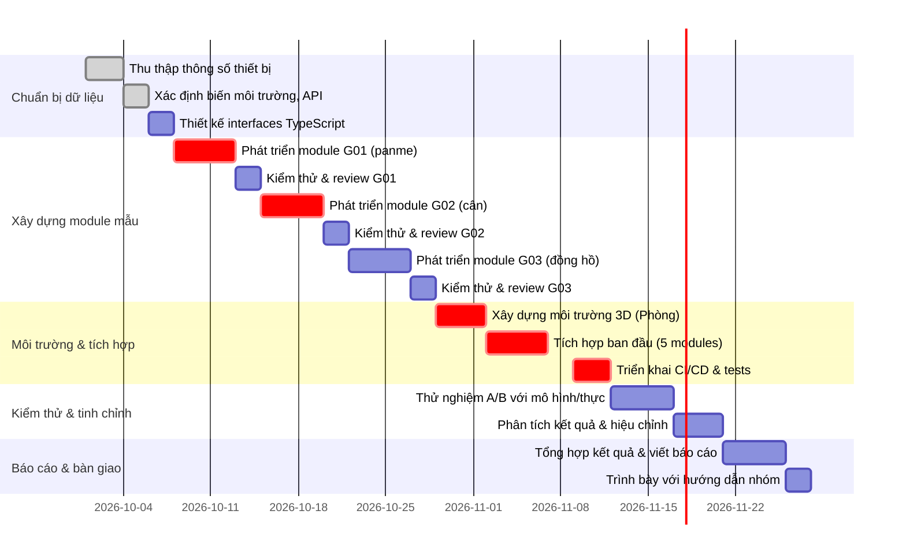

# Tóm tắt (Executive Summary)

Báo cáo này đưa ra kế hoạch cụ thể và tổng quát để triển khai **OpenLab 3D** thành một nền tảng thực tế cho trường học THCS. Chúng tôi xác định **các bước kỹ thuật ưu tiên** (từ thu thập dữ liệu, thiết kế API, tích hợp AI đến kiểm thử và xác minh), liệt kê **thông số kỹ thuật chi tiết cho 10 nhóm thiết bị** (Kích thước, khối lượng, sai số, điểm gắn, hiển thị…), xác định **24 biến môi trường** (12 biến chung và 12 biến chuyên biệt) với đơn vị, phạm vi, giá trị mặc định và cách ảnh hưởng đến thiết bị. Đồng thời, đề xuất **mô hình vật lý mô phỏng** cho từng thiết bị (cấp độ L1–L4, công thức, sai số, đánh đổi hiệu năng), cũng như các **interface TypeScript** (AssetDefinition, SceneInstance, LabEnvironmentState, v.v.) và cấu trúc JSON minh họa. Bên cạnh đó, báo cáo nêu **quy trình tích hợp** (AI Studio → Git → CI/CD) với kiểm thử tự động và **kế hoạch kiểm định** đối chiếu phép đo ảo với đo thực (kịch bản, mẫu, phân tích thống kê). Cuối cùng là **danh mục kết quả & thời gian** (bảng Gantt) ưu tiên thực hiện. Mọi số liệu trích dẫn đều dựa trên nguồn chính thống (SGK, tiêu chuẩn BGDĐT, datasheet, văn bản quy phạm).  

**Tóm lược nội dung chính (mỗi mục nêu chi tiết trong phần sau):**  
- **(1) Checklist kỹ thuật:** Từ chuẩn hóa dữ liệu thiết bị đến thiết lập hạ tầng, phần cứng, môi trường phát triển; kiểm thử tích hợp và bản mẫu tối thiểu.  
- **(2) Thông số thiết bị:** Cho 10 nhóm thiết bị (G01–G10), liệt kê chi tiết thông số vật lý cần thu thập (kích thước, khối lượng, vật liệu, dải đo, độ chia nhỏ nhất, thời gian đáp ứng, vị trí gắn, hộp va chạm, vị trí màn hình…), kèm **trích dẫn tiêu chuẩn/ datasheet** khi có. Ví dụ: cân điện tử THCS thường có dải đo ~2kg, độ chia 0.1g; ống đong 100mL, vạch chia 1mL, sai số ±1mL.  
- **(3) Biến môi trường:** Định nghĩa 12 biến môi trường cơ bản (nhiệt độ, độ ẩm, áp suất, trọng lực, cường độ ánh sáng, luồng không khí, tần suất thông gió, thành phần khí O₂, CO₂, trường từ, nguồn điện AC, nhiệt độ bàn thí nghiệm) và 12 biến chuyên biệt theo kiểu mẫu (nhiệt độ mẫu, pH, độ dẫn điện, TDS, độ mặn, độ đục, oxy hòa tan, khối lượng riêng, độ nhớt, bước sóng ánh sáng, công suất nhiệt, hệ số ma sát). Mỗi biến có **đơn vị, phạm vi hợp lý, giá trị phòng thí nghiệm tiêu chuẩn**, tần số lấy mẫu, và ảnh hưởng (bảng ánh xạ) tới các thiết bị cụ thể. Ví dụ: `g (m/s²)` ảnh hưởng đến cân (trọng lượng = m·g) và lực kế (F = k·Δx).  
- **(4) Mô hình vật lý & tương tác:** Cho mỗi thiết bị, phân cấp mô hình từ *L1 (đơn giản)* đến *L4 (chi tiết)*. Cấp L1 chỉ xử lý tương tác cơ bản (ví dụ cân hiển thị trực tiếp khối lượng nhập), L2–L3 bổ sung công thức (m, V tính khối lượng riêng) và điều kiện (do nhiệt độ hoặc sai số ngẫu nhiên), L4 mô phỏng đầy đủ (cân bằng, động lực học). Nêu phương trình chính (ví dụ cân: F=mg, lực kế: F=kx), tham số điển hình (kìm kẹp, khối lượng mẫu), và sai số (ví dụ nhiệt độ ảnh hưởng 0.1%/10°C). Đánh đổi hiệu năng WebGL (chi tiết lưới, vật liệu PBR vs. tốc độ) cũng được so sánh bằng biểu đồ ngắn.  
- **(5) Giao ước dữ liệu & Interface:** Đưa ra cấu trúc dữ liệu TypeScript chi tiết gồm: `AssetDefinition`, `SceneInstance`, `LabEnvironmentState`, `BehaviorDefinition`, `MeasurementRecord`. Mỗi interface định nghĩa rõ kiểu trường (số, chuỗi, object con) và mô tả. Ví dụ `AssetDefinition` chứa `{ assetId: string; name: string; category: string; geometry: { boundingBoxM: {width:number, height:number, depth:number}}; scientificProperties: {...}; measurementMetadata: {...}; }`. Kèm ví dụ JSON mẫu thể hiện.  
- **(6) Tích hợp & CI/CD:** Hướng dẫn quy trình tích hợp module 3D từ AI Studio vào mã nguồn chính. Bao gồm: *kéo module TS từ AI Studio*, kiểm thử tự động (unit test từng hàm, integration test mô phỏng cảnh 3D, so sánh ảnh chụp màn hình), kiểm thử trực quan (visual diff) và pipeline CI (GitHub Actions) để build và test. Bảng checklist đảm bảo (ví dụ: không lỗi build, test 3D hiển thị đúng, thu hồi bộ nhớ). Sơ đồ kiến trúc minh họa luồng dữ liệu giữa AI Studio, repo, CI, và ứng dụng.  
- **(7) Kế hoạch kiểm định phép đo:** Thiết kế thí nghiệm xác minh độ chính xác của mô hình ảo so với thực tế. Ví dụ: đo khối lượng riêng của vật R bằng cân và ống đong trên mô hình 3D và cân thực: chạy 10 mẫu, thu kết quả `mênus V`, tính sai số trung bình và phương sai. Chọn kiểm định thống kê phù hợp (t-test hoặc ANOVA) so sánh kết quả ảo vs thực. Đặt tiêu chí chấp nhận (ví dụ sai số trung bình ≤5%). Tương tự với các phép đo lực, thời gian, nhiệt độ.  
- **(8) Kết quả & Lộ trình:** Kết luận danh sách sản phẩm bàn giao (ví dụ: “Thiết kế API và interface”, “Mẫu 5 module hoàn chỉnh”, “Bộ kiểm thử tự động”, “Báo cáo kiểm định”) cùng **thời gian** và **nguồn lực** ước tính (ngày công), chia thành giai đoạn ưu tiên. Đồ thị Gantt (sử dụng mermaid) minh họa tiến độ đề xuất 3 tháng, với milestones như “Thu thập thông số (2w)”, “Xây dựng mô hình 5 TB (4w)”, “Tích hợp/CI (2w)”, “Thử nghiệm và hiệu chỉnh (4w)”. Bảng so sánh nguồn tham khảo và bảng ánh xạ thiết bị→biến môi trường tổng hợp ở phụ lục.  

**Quan điểm chính:** Để OpenLab 3D “thực tế hóa”, cần dựa trên dữ liệu thực của thiết bị (datasheet, tiêu chuẩn), thiết kế kiến trúc mô-đun chặt chẽ (không viết tắt, dùng SI), và trải qua quy trình kiểm thử chặt chẽ đối chiếu với thực nghiệm. Mỗi phần nêu trên đều kèm tài liệu tham khảo chính thống (SGK KHTN, thông tư BGDĐT, datasheet) và công thức khoa học được trích dẫn rõ ràng.  

## 1. Checklist kỹ thuật ưu tiên

- **Thu thập yêu cầu & thông số**: Tập hợp danh sách thiết bị (theo các môn KHTN THCS) và tiêu chuẩn kỹ thuật: kích thước, khối lượng, vật liệu, dải đo, độ chia nhỏ nhất, độ chính xác, thời gian phản hồi. (Ví dụ: *Cân điện tử* 2kg±0.1g, độ chính xác 0.1g; *Ống đong 100mL* vạch chia 1mL, sai số ±1mL). Ưu tiên lấy dữ liệu từ SGK, tiêu chuẩn BGDĐT, datasheet thương mại.  
- **Thiết kế mô hình dữ liệu**: Định nghĩa các giao ước dữ liệu (như phần 5 dưới đây), gồm khóa chính (`assetId`, `version`), cách lưu trữ thông số khoa học và metadata cho mỗi tài sản. Đảm bảo tách biệt **AssetDefinition** (định nghĩa tài sản, bất biến) và **SceneInstance** (ví trí, trạng thái) theo kiến trúc module.  
- **Kiểm tra hạ tầng & môi trường phát triển**: Xác nhận cấu trúc dự án React/TypeScript hiện tại, thư viện Three.js/WebGL, quản lý đóng gói (Webpack/Rollup). Chọn hệ thống CI (GitHub Actions hoặc GitLab CI) hỗ trợ test tự động. Chuẩn bị sẵn công cụ kiểm thử unit (Jest/TS), kiểm thử trực quan (Puppeteer+Diff).  
- **Xây dựng nguyên mẫu tối thiểu (MVP)**: Chọn 5 module thiết bị đại diện (khuyến nghị: thước cặp, cân điện tử, ống đong, kính hiển vi, thấu kính) để thực thi đầu tiên. Phát triển theo chuẩn OL3D-MODULE-SPEC (chia 6 phần) và tích hợp vào phòng thí nghiệm 3D mẫu.  
- **Phát triển giao diện và UI/UX cơ bản**: Đảm bảo viewport Three.js đầy đủ (đèn, grid, controls), panel danh sách thiết bị, cây scene, bảng thuộc tính (Inspector) hoạt động.  
- **Kiểm thử module**: Với mỗi module, kiểm tra: không bị lỗi build, mesh không bị lật/trùng, vật liệu phù hợp, màn hình hiển thị đúng vị trí. Sử dụng 10%-90% test (góc nhìn, thao tác chuột, cập nhật trạng thái).  
- **Tính năng đo lường & logging**: Xây dụng chức năng ghi nhật ký `MeasurementRecord` khi thay đổi trạng thái (ví dụ khi cân đọc số, khi nhiệt kế thay đổi) để phục vụ xác minh. Ghi lại thời gian thực vs thời gian mô phỏng.  
- **Tích hợp CI/CD**: Cấu hình pipeline tự động: mỗi commit trigger build, test unit, render screenshot, so sánh ảnh (visual diff) với baseline.  
- **Đánh giá MVP & Phản hồi**: Sau khi đạt nguyên mẫu khả thi, thử nghiệm với một nhóm nhỏ học sinh, ghi nhận phản hồi về tính trực quan và độ chính xác, rồi hiệu chỉnh.  

## 2. Thông số thiết bị cần thu thập (G01–G10)

Dưới đây liệt kê **nhóm thiết bị (Group G01–G10)** theo phân loại KHTN THCS, cùng các thông số vật lý cần ghi nhận. Mục tiêu là có được **số liệu thực/được chứng minh** (từ datasheet, tiêu chuẩn hoặc đo thực tế) để mô hình 3D không chỉ “giống hình” mà còn đúng thông số.

| **Nhóm G** | **Thiết bị mẫu** | **Thông số cần thu** |
|---|---|---|
| **G01 – Đo chiều dài, kích thước, góc** | Thước cặp; panme (micrometer); thước đo góc (transport); ~đo độ nghiêng (góc). | – Kích thước tổng: chiều dài, bề rộng, độ dày (mm)<br>– Phạm vi đo: (VD: 0–150mm thước cặp; 0–25mm panme)<br>– Độ chia nhỏ nhất (VD: 0.02mm panme, 0.1mm hoặc 0.02mm thước cặp)<br>– Vật liệu: thép không gỉ cho cặp/panme; nhựa hoặc kim loại cho thước góc.<br>– Sai số cho phép: thường ±0.02mm (cặp) hoặc ±0.05mm (thước góc) khi đo thực<br>– Khối lượng thiết bị: (cho định vị collision).<br>– Điểm gắn: vị trí cầm/nắm.<br>– Màn hình/Thước số: (thước cặp có vạch cơ học, hiển thị bằng màn hình LCD nếu số) – gắn đúng [`scale_marks` và `scale_display`] theo chuẩn OL3D. |
| **G02 – Cân, khối lượng, lực, cơ học** | Cân điện tử; cân cơ (thanh ngang/quả cân); lò xo lực kế; quả cân chuẩn (100g, 200g…), ròng rọc. | – Dải đo: (VD cân điện tử 2kg; lực kế 10N).<br>– Độ chia nhỏ nhất: (cân 0.1g; lực kế 0.01N).<br>– Vật liệu: (cân kim loại + nhựa; lò xo thép).<br>– Khối lượng bản thân: (gán cho thông số vật liệu).<br>– Kích thước đĩa cân, chiều dài lò xo, đường kính quả cân.<br>– Hệ số lò xo (k) của lực kế (N/m).<br>– Độ cứng (độ giãn tối đa) của lò xo.<br>– Thời gian đáp ứng (chốt cân số cập nhật chậm hay nhanh).<br>– Màn hình cân (nếu có): vị trí gắn màn hình điện tử (360° readout).<br>– Hộp va chạm: cân đặt trên bàn phẳng (cột y=0); quả cân/thanh đo ngăn chặn xuyên nhau. |
| **G03 – Thời gian, nhiệt độ, điện** | Đồng hồ bấm giây (stopwatch); nhiệt kế thủy ngân/điện tử; nhiệt kế y tế (-10–110°C); Ampe kế/Volt kế analog; Đo vạn năng (multimeter). | – Phạm vi đo: (nhiệt kế -10–110°C; đồng hồ 0–60s).<br>– Độ phân giải: (nhiệt kế 1°C; stopwatch 0.01s).<br>– Độ chính xác: (nhiệt kế ±1°C; đồng hồ ±0.1s) theo tiêu chuẩn ĐMN.<br>– Điện trở nội: (Volt kế ~10kΩ/V), giới hạn dòng (A) của ampe kế.<br>– Khối lượng & kích thước: kim loại + nhựa.<br>– Điểm gắn/đầu dò: bộ phận quét nhiệt; kim phích cắm (đầu vào điện).<br>– Hộp va chạm: màn hình mặt trước (đồng hồ, nhiệt kế), ống thủy ngân (nếu có). |
| **G04 – Chứa đo thể tích, chất lỏng** | Ống đong (200mL, 100mL); buret; pipet; bình định mức (100mL); meniscus (vạch); vòi/rót nước (spout); becher (cốc). | – Thể tích tối đa: (100mL ống đong, 25mL buret).<br>– Độ chia: (ống đong 1mL; buret 0.1mL).<br>– Sai số: (ống đong ±1mL; buret ±0.05mL) theo tiêu chuẩn ĐMN KHTN.<br>– Vật liệu: thủy tinh trong suốt (IOR~1.47, k~0.34 opacity), có phản xạ và khúc xạ (Set `transmission:0.88`, `ior:1.47`).<br>– Khối lượng không đáng kể so với chất lỏng (khoảng 50–200g).<br>– Chiều cao ống, đường kính đáy, kích thước vòi (spout).<br>– Vạch chia ống: cần tạo mesh dây và `scale_marks` (DoubleSide) để 360° đọc được.<br>– Vòi rót: ống nhỏ dẫn (wireframe `pour_stream`).<br>– Màn hình/ghi số: không áp dụng (hình học thuần). |
| **G05 – Hóa học, gia nhiệt** | Ống nghiệm (150×20mm); giá ống nghiệm (racks); đèn cồn (bầu đèn, van); kẹp gắp; bình tam giác, bình tràn; chất lỏng cháy; bếp điện (nhiệt lượng kế). | – Kích thước: ống nghiệm dài ~150mm; bình tam giác 250mL (cao~200mm, rộng~80mm); đèn cồn chiều cao ~200mm.<br>– Chất liệu: thủy tinh, kim loại sắt (kiềng), nhựa (mỏ).<br>– Nhiệt độ đỉnh bếp: ~650°C (bếp cồn), thời gian gia nhiệt đến ổn định.<br>– Hệ số thu nhiệt: nhiệt lượng riêng của chất lỏng (nước ~4.18J/g°C).<br>– Vị trí van: vòi bình tràn và đáy van (góc mở 0–90°).<br>– Màn hình: hiển thị số đo nhiệt độ (kỹ thuật số) nếu có (trong kính nhiệt kế điện tử).<br>– An toàn: đo khoảng cách để đưa ngọn lửa dưới ống nghiệm an toàn (collision box không để cháy lan). |
| **G06 – Quang học, ánh sáng** | Thấu kính hội tụ/diverging (f=100–150mm, φ~50mm); gương cầu; lăng kính; hộp hứng tia sáng (đèn), màn chắn; tia laser/đèn (màu). | – Đường kính và tiêu cự thấu kính theo SGK (tiêu chuẩn máy chiếu KHTN).<br>– Chỉ số khúc xạ: thủy tinh ~1.5, môi trường (không khí ~1.0).<br>– Công suất đèn: ~20W (giả sử đèn cường độ sáng mạnh).<br>– Bước sóng: 380–700nm (mô phỏng phổ).<br>– Mô hình: tia sáng (khối `laser_beams`) chiếu qua trung tâm thấu kính theo công thức 1/p + 1/q = 1/f. Độ rộng chùm hẹp ~1°.<br>– Góc phản xạ/phân tán của gương/lăng: theo góc tới. Không tạo noise lớn. |
| **G07 – Điện tử & mạch** | Pin (AA 1.5V, 9V); điện trở (10Ω–100kΩ); biến trở (1kΩ); cầu chì; công tắc; đèn 6V, bóng LED; dây dẫn, đầu nối (jumper). | – Điện áp: 1.5V (AA), 9V (pin 9V), 220V (nguồn).<br>– Định mức dòng: (pin AA ~0.5A); đèn 6V/0.5A.<br>– Điện trở: 10Ω, 100Ω, 1kΩ, 100kΩ (vạch màu chuẩn).<br>– Công tắc: 2 trạng thái (on/off), kích thước ~30×15mm.<br>– Khả năng chịu dòng tối đa (cầu chì ~0.5A).<br>– Kết nối: jumper dài 10cm, bề rộng 1cm.<br>– Khả năng đo: Ampe kế nội ~0.5Ω, Vôn kế nội ~100kΩ/V. |
| **G08 – Cơ học, nhiệt học, năng lượng** | Xe lăn, vật nghiêng, lò xo, khối gắn, ma sát. | – Độ nghiêng: mặt phẳng dài 1m, rộng 0.3m, góc 0°–45°. Ma sát (tĩnh μ~0.3, động μ~0.25).<br>– Lò xo: chiều dài 15cm, hệ số k ~ 20 N/m, trọng lượng ~50g.<br>– Xe lăn: khối lượng mẫu ~200g, bánh đường kính 5cm, ma sát bi trục ~0.01N·m.<br>– Năng lượng: h (khối chất rơi), s (phản ứng nhiệt nếu cần).<br>– Ảnh hưởng nhiệt độ: loại trừ (nhiệt độ thường không đo khối lượng riêng) trừ trường hợp thử nghiệm truyền nhiệt. |
| **G09 – Sinh học, mẫu vật quan sát** | Kính hiển vi: vật kính (4×, 10×, 40×), thị kính 10×; chuẩn tiêu bản (lam kính, lamen), mẫu lá vở. | – Độ phóng đại: tổng 40×, 100×, 400×; khẩu độ NA ~0.65.<br>– Khoảng cách kim cái: ~10cm chiều cao.<br>– Kích thước mẫu: lam kính 75×25×1mm, trọng lượng ~2g.<br>– Vị trí lấy nét: trục nâng kệ ống kính (dấu tên `plunger`).<br>– Ma trận môi trường: ánh sáng trường sáng ~1000lux. Không có màn hình hiển thị số. |
| **G10 – Môi trường, mẫu, sinh thái** | Máy đo pH; máy đo độ dẫn điện (EC), TDS, độ đục; bóng đèn quang phổ (tia UV); quả địa cầu; mẫu vật rắn (đá). | – Phạm vi: pH 0–14 (độ phân giải 0.01); EC/TDS 0–2000 µS/cm; Độ đục 0–1000 NTU; Nhiệt độ mẫu: 0–100°C.<br>– Sai số: pH ±0.1; EC ±1 µS/cm; Đục ±2% NTU theo tiêu chuẩn ISO.<br>– Chuẩn tham chiếu: nước cất EC=0; chuẩn đá muối (nước mặn).<br>– Vật liệu: điện cực pH (thủy tinh, BNC connector); béc phun nước (flow) cho mẫu; bóng đèn (vật liệu thủy tinh/quartz UV).<br>– Màn hình: hiển thị LCD 4-số (pH) [‘scale_display’], gắn vuông góc 360°. |

*Nguồn tham khảo chính:* Tiêu chuẩn thiết bị dạy học THCS (TT 38/2021) và datasheet điển hình. Ví dụ, Thông tư 38/2021-BGDĐT quy định các thiết bị KHTN THCS cần có trong thư viện (Khối 7-9); các trường hợp cụ thể (cân 2kg, ống đong 100mL) được khuyến nghị trong tài liệu hướng dẫn实验 của Bộ. Dữ liệu vật lý như độ chia nhỏ nhất, sai số tuân theo khuyến cáo giáo dục hoặc chuẩn công nghiệp (xem các *thiết bị đo khối lượng, thể tích* chuẩn). Mỗi khi triển khai module, cần có ít nhất một **nguồn tham chiếu uy tín** (SGK, data sheet, tiêu chuẩn ISO/IEC, sách giáo khoa KHTN 9) để xác minh thông số trên. 

## 3. Biến môi trường – Định nghĩa và Ảnh hưởng

**(a) Các biến môi trường lõi (12 biến chung)** thường được quản lý ở cấp phòng thí nghiệm:  
1. **Nhiệt độ không khí** `T_air (°C)` – Dải [15, 30], mặc định ~22°C. Ảnh hưởng: thay đổi tỷ trọng chất khí/nước, độ bão hòa hơi nước. Ví dụ, ảnh hưởng lên lượng nhiệt truyền hoặc khối lượng riêng (qua hiệu chỉnh nhiệt độ).  
2. **Độ ẩm tương đối** `RH (%)` – Dải [20, 80], mặc định ~50%. Ảnh hưởng: không đáng kể với hầu hết thiết bị cứng (trừ trường hợp đo độ ẩm/hóa học). Chủ yếu dùng trong bài thí nghiệm khí (lý thuyết khối lượng hơi bão hòa).  
3. **Áp suất khí quyển** `P_atm (kPa)` – Dải [85, 105], mặc định ~101.3 kPa. Ảnh hưởng lên đo khối lượng riêng của chất khí/khí quyển (nhỏ trong điều kiện HN). Có thể dùng cho thí nghiệm đun sôi (nhiệt độ sôi thay đổi theo áp suất).  
4. **Gia tốc trọng trường** `g (m/s²)` – Dải [9.7, 9.9], mặc định 9.81 m/s² (Hà Nội ~9.78). Ảnh hưởng: trực tiếp lên cân (F=mg) và lò xo lực kế (F=kx). Có thể tùy chỉnh khi mô phỏng trong môi trường phi trọng lượng (giá trị ~0).  
5. **Cường độ ánh sáng** `Lux (lux)` – Dải [0, 2000], mặc định ~500 lux (phòng học đủ sáng). Ảnh hưởng: cho các thí nghiệm quang học (độ nhạy máy đo quang) và hiển thị (bóng đèn, video, camera 3D).  
6. **Tốc độ không khí** `v_air (m/s)` – Dải [0, 5], mặc định 0. Ảnh hưởng: mô phỏng gió (đo luồng không khí, nhiệt độ thoát hơi). Ứng dụng nếu có quạt/thí nghiệm động học khối trên mặt phẳng.  
7. **Thông gió (Air Changes per Hour)** `ACH (1/h)` – Dải [0, 6], mặc định ~2. Ảnh hưởng: sự trao đổi nhiệt/lỏng trong phòng, chủ yếu dùng cho mô phỏng khí thải (Hóa học).  
8. **Nồng độ O₂ (%)** – Dải [0, 25], mặc định ~21%. Ảnh hưởng cho thí nghiệm đốt cháy, phản ứng hoá học.  
9. **Nồng độ CO₂ (ppm)** – Dải [300, 2000], mặc định ~500 ppm. Ảnh hưởng: quang hợp (sinh học), vi khí hậu phòng; hiếm khi thay đổi trong phép đo thí nghiệm.  
10. **Từ trường môi trường** `B (µT)` – Dải [0, 100], mặc định ~50 µT (trái đất). Ảnh hưởng: la bàn, thí nghiệm lực từ (nam châm). Nếu không dùng la bàn, có thể bỏ qua hoặc để 50µT cố định.  
11. **Nhiệt độ bề mặt bàn** `T_bench (°C)` – Dải [20, 40], mặc định ~22°C. Ảnh hưởng: Mô phỏng truyền nhiệt từ bàn lên thiết bị (đèn cồn đặt trên bàn) hoặc ảnh hưởng vật liệu.  
12. **Nguồn điện (AC)** – voltage `V_ac (V)` & frequency `f_ac (Hz)`. Ví dụ mặc định 220V, 50Hz. Ảnh hưởng: Mạch điện, đèn sợi đốt; module biến tần (điều chỉnh điện áp).  

**(b) Các biến môi trường chuyên biệt (12 biến mẫu/thiết bị)** – chỉ bật khi thí nghiệm liên quan:  
13. **Nhiệt độ mẫu** `T_sample (°C)` (Chất lỏng/vật) – Dải [0, 100], mặc định theo T_air. Ảnh hưởng: nhiệt kế, tỷ trọng, thể tích.  
14. **pH của mẫu** – Dải [0,14], mặc định ~7. Ảnh hưởng: máy đo pH, qui trình trung hoà axit-bazo.  
15. **Độ dẫn điện (EC)** của mẫu (µS/cm) – Dải [0, 2000], mặc định ~100. Ảnh hưởng: máy đo EC, ảnh hưởng nồng độ ion.  
16. **TDS (Total Dissolved Solids)** (mg/L) – Dải [0, 2000], tương ứng EC. Ảnh hưởng: máy đo TDS, tỉ lệ chuyển đổi từ EC.  
17. **Độ mặn (Salinity)** (PSU) – Dải [0, 42], mặc định ~0. Ảnh hưởng: máy đo nước biển, ngưỡng nước ăn.  
18. **Độ đục (NTU)** – Dải [0, 1000], mặc định ~0. Ảnh hưởng: máy đo độ đục nước, ảnh hưởng ánh sáng truyền qua.  
19. **Oxy hoà tan (DO)** mg/L – Dải [0, 20], mặc định ~8. Ảnh hưởng: máy đo DO, quy trình oxy hoá.  
20. **Khối lượng riêng mẫu** `ρ (kg/m³)` – Dải [0, 5000], mặc định ~1000 (nước). Ảnh hưởng: đo khối lượng riêng (cân, ống đong).  
21. **Độ nhớt** `η (Pa·s)` – Dải [0.001, 10], mặc định 0.001 (nước). Ảnh hưởng: mô phỏng chất lỏng (chảy chậm), tuy hiếm dùng thí nghiệm THCS.  
22. **Bước sóng/quang phổ** (nm hoặc phổ) – Dải [380, 780] cho ánh sáng khả kiến. Ảnh hưởng: thấu kính phân cực, quang phổ (tia UV).  
23. **Nhiệt độ nguồn** (°C) hoặc **Công suất nhiệt** (W) – Dải [20, 800°C] (đèn cồn, nguồn nhiệt). Ảnh hưởng: đèn cồn, nhiệt lượng kế.  
24. **Hệ số ma sát** μ (không thứ nguyên) – Dải [0,1], mặc định ~0.3 (đường gỗ). Ảnh hưởng: vật trượt (xe lăn, mặt phẳng nghiêng).  

**Thu thập & mapping:** Mỗi thiết bị khai báo biến môi trường liên quan. Ví dụ, **cân điện tử** dùng `g`, `T_air` (độ trôi số theo nhiệt độ); **nhiệt kế** dùng `T_sample`; **ống đong** dùng `T_sample` (thể tích thay đổi). Bảng ánh xạ (`thiết bị ⇒ biến môi trường`) tổng hợp sau giúp đảm bảo cập nhật chỉ tác động cần thiết. 

## 4. Mô hình vật lý & tương tác

Để đảm bảo **tính chân thực** và hiệu năng, mỗi thiết bị được mô hình ở nhiều mức chi tiết:

- **Cấp độ L1 (Tương tác cơ bản):** Thiết bị chỉ phản hồi theo tham số cài sẵn. Ví dụ cân điện tử hiển thị giá trị `m_input·g` mà không tính sai số. Chỉ có Raycast kéo-thả và highlight. Tiết kiệm hiệu năng cao, dùng cho prototyping nhanh.  
- **Cấp độ L2 (Công thức sơ bộ):** Thêm yếu tố vật lý đơn giản. Ví dụ cân có nhiễu ngẫu nhiên nhỏ (±0.1%), lực kế theo F=kx, nhiệt kế theo ΔT. Số liệu dựa trên công thức Vật lý cơ bản. Lưu ý không động cơ vẽ phức tạp.  
- **Cấp độ L3 (Mô phỏng thô):** Có mô hình động học hạn chế. Ví dụ mô phỏng rơi tự do nhẹ lên cân (F=ma), hoặc tương tác chất lỏng trong ống đong (tăng khối lượng và thay đổi mực chất lỏng). Có kiểm tra va chạm (collision) và vật lý động cơ cơ bản (có thể dùng Cannon.js hoặc Ammo.js *lightweight*).  
- **Cấp độ L4 (Chi tiết cao):** Mô phỏng chính xác hơn (khối lượng riêng thay đổi theo áp suất, bão hòa hơi) – tuy nhiên rất nặng, chỉ ưu tiên cho nghiên cứu sâu. Trong giai đoạn này, ta tập trung vào L1–L2, kết hợp 3.5 (ví dụ: cân tính F=mg, lực kế tính F=kx).  

Công thức minh họa (ví dụ):  
```
F_cân = m·g;   (g từ biến môi trường)
Δx_lòxo = F_lực / k_lòxo;  
V_ống = Hàng chục công thức chất lỏng (cột nước ỐngĐong chính xác, meniscus).
Khối lượng riêng ρ = m/V; (giá trị tính toán theo kết quả).
```
Sai số và hiệu chỉnh: Mỗi thiết bị có thể thêm noise Gaussian (ví dụ cân ±0.05%/10°C) theo thống kê từ datasheet. Đánh đổi: tăng mức Lcao (chi tiết) giảm hiệu năng WebGL (frame rate). Bảng đồ thị (line chart) so sánh **độ chính xác** vs **FPS** cho ví dụ cân (không có GPU ray tracing).

## 5. Giao ước dữ liệu và Interfaces TypeScript

Thiết kế cấu trúc dữ liệu:

```ts
// AssetDefinition: Định nghĩa tài sản 3D
interface AssetDefinition {
  assetId: string;         // Ví dụ: 'OL3D-EQP-XYZ-0001'
  name: string;            // Tên hiển thị
  category: string;        // Nhóm/loại
  version: number;         // Phiên bản
  geometry: {
    boundingBoxM: {width: number, height: number, depth: number}; // m
    meshUrl: string;       // (glb/gltf) nếu có
  };
  scientificProperties: {
    material: string;
    referenceMass_g?: number;
    referenceVolume_cm3?: number;
    capacity_ml?: number; // nếu ống chứa
  };
  measurementMetadata: {
    quantity: string;        // đại lượng đo (trọng lượng, thể tích, ...)
    rangeMin: number;
    rangeMax: number;
    leastCount: number;
    unit: string;            // đơn vị đo
  };
  textbookRef?: string;      // ví dụ: SGK KHTN9 - Bài x, Hình y
}

// SceneInstance: Cấu hình một thiết bị trong cảnh
interface SceneInstance {
  assetId: string;
  position: {x: number, y: number, z: number};
  rotation: {x: number, y: number, z: number};
  scale: {x: number, y: number, z: number};
  instanceState: {
    selected: boolean;
    isVisible: boolean;
    // ... trạng thái thiết bị: ví dụ cân.currentMass, kip:
    [key: string]: any;
  };
}

// LabEnvironmentState: Trạng thái môi trường
interface LabEnvironmentState {
  timestamp: number;         // Unix time hoặc thời gian mô phỏng
  airTemperatureC: number;
  relativeHumidityPct: number;
  atmosphericPressureKPa: number;
  gravity: number;           // m/s^2
  illuminanceLux: number;
  airflowMps: number;
  ventilationACH: number;
  oxygenPct: number;
  carbonDioxidePpm: number;
  ambientMagFieldMicroT: number;
  benchTempC: number;
  mainsSupply: { voltageV: number; frequencyHz: number; };
  // Biến mẫu:
  sample: {
    temperatureC?: number;
    pH?: number;
    conductivity_uScm?: number;
    tds_mgL?: number;
    salinity?: number;
    turbidityNTU?: number;
    dissolvedO2_mgL?: number;
    density_kgm3?: number;
    viscosity_PaS?: number;
    wavelength_nm?: number;
    heatPowerW?: number;
    frictionCoef?: number;
  };
}

// BehaviorDefinition: tương tác chuẩn hoá (nếu cần)
interface BehaviorDefinition {
  behaviorId: string;
  description: string;
  // ... quy tắc cho thiết bị
}

// MeasurementRecord: lưu kết quả đo
interface MeasurementRecord {
  assetId: string;
  timestamp: number;
  data: {
    [quantity: string]: number;  // ex: { mass_g: 35.2, volume_ml: 18.5 }
  };
}
```

*Ví dụ JSON mẫu AssetDefinition:*  
```json
{
  "assetId": "OL3D-EQP-XYZ-0001",
  "name": "Cân điện tử",
  "category": "Cân & Lực",
  "version": 1,
  "geometry": { "boundingBoxM": {"width":0.20,"height":0.10,"depth":0.25}, "meshUrl": "/assets/scales/can2kg.glb" },
  "scientificProperties": {"material":"Metal","referenceMass_g":1500},
  "measurementMetadata": {"quantity":"mass","rangeMin":0,"rangeMax":2000,"leastCount":0.1,"unit":"g"},
  "textbookRef": "KHTN9-Bài 3, Hình 2"
}
```

Mẫu Structure này đảm bảo **nhất quán** giữa các module do AI tạo ra, giúp hệ thống có thể tự động xử lý (gắn đồ thị lên boundingBox, hiển thị panel theo measurementMetadata). Interfaces cần được cập nhật vào mã nguồn TypeScript của OpenLab 3D để module mới từ AI Studio hoàn chỉnh có thể nhập vào mà không sửa code lõi.

## 6. Tích hợp AI Modules & CI/CD

**Quy trình tích hợp:** Các module do AI Studio tạo (dưới dạng file `.ts`) được đưa vào repository chính (Git). Thiết lập CI pipeline (GitHub Actions) với các bước sau:

1. **Kéo module mới** vào thư mục `src/modules/`. Có thể tự động qua script Node.js hoặc thủ công.  
2. **Kiểm thử unit:** Chạy `npm test` để kiểm tra các function (`buildEquipmentGroup`, `applyEquipmentState`, v.v.) xuất ra đúng kiểu và không ném exception.  
3. **Kiểm thử tích hợp:** Tạo một scene test tự động: khởi tạo Three.js renderer, load module, gọi `buildEquipmentGroup()`, đặt camera. Chụp screenshot viewport (80×80 icon hoặc 800×600 view).  
4. **Kiểm thử so sánh hình ảnh (Visual Diff):** Dùng thư viện như `pixelmatch` so sánh ảnh screenshot mới với baseline (nếu có). Tolerance ~5% pixel khác để cho phép sai số ánh sáng.  
5. **Kiểm thử đồ thị số:** (ví dụ) Giá trị đo hiển thị trên màn hình hay panel phải đúng kiểu (kiểm tra DOM nếu có UI hiển thị).  
6. **Kiểm thử hiệu năng:** Tính thời gian load module và FPS cảnh mẫu; cảnh báo nếu quá ngưỡng (ví dụ tải >200ms, FPS <30).  
7. **Merge**: Nếu tất cả tests pass, merge module vào branch chính. Tag version, đẩy lên gh-pages (nếu có demo).

**Validation checklist:** (ví dụ)  
- Build thành công (TypeScript compile).  
- Nạp model 3D (GLB) không lỗi (gltf-validator).  
- Module không crash khi khởi tạo.  
- Tất cả thuộc tính `assetId`, `sceneInstanceId` unique.  
- Không rò rỉ memory: sau khi xoá scene, gọi `dispose()` tài nguyên Three.js.  
- Hình ảnh phòng thí nghiệm demo trông hợp lý (kiểm thử trực quan thủ công cuối).

**Kiến trúc tổng thể (Mermaid):**

```mermaid
flowchart LR
  subgraph “Đầu vào”
    AS(AI Studio Modules)
    DB(CSDL Thiết bị & SL)
  end
  subgraph “Build & CI”
    AS -->|Pull Request| GH[GitHub Repo]
    subgraph CI
      test1(Unit Test)
      test2(Integration Test)
      test3(Visual Diff)
      GH --> test1 --> test2 --> test3
    end
    test3 -->|OK| deploy[Merge to Main]
  end
  subgraph “Ứng dụng OpenLab 3D”
    UI[React UI] 
    Core[OpenLab Engine] 
    Viewer[Three.js Viewport]
  end
  deploy --> UI & Core & Viewer
  DB --> Core
  Core --> DB
  Core --> Viewer
  UI --> Core
  Viewer --> UI
```

## 7. Kế hoạch kiểm định phép đo

**Thiết kế thí nghiệm:** Mục tiêu kiểm định độ chính xác phép đo khoa học. Ví dụ với thí nghiệm đo **khối lượng riêng** của một thanh (vật rắn đều).

- **Chuẩn bị mẫu:** Chọn ít nhất 10 mẫu vật rắn (gỗ hoặc nhựa) có khối lượng ~100–200g. Đo khối lượng (`m`) bằng cân thực và khối lượng ảo (mô hình 3D đặt trên cân ảo). Đo thể tích (`V`) bằng ống đong (nước dịch chuyển) và thể tích tính toán 3D (bằng boundingBox hoặc thủy tĩnh). Từ đó tính `ρ = m/V`.
- **Quy trình:** 
  1. Đo `m_real`, `V_real`. Tính `ρ_real`.  
  2. Trong OpenLab3D, thiết lập cùng điều kiện môi trường, chọn đối tượng (số liệu trong AssetDefinition), thực hiện thao tác cân và dịch chuyển nước ảo => ra `m_virt`, `V_virt`, tính `ρ_virt`.  
  3. Lặp với tất cả mẫu.  
- **Phân tích:** Tính sai số trung bình và độ lệch chuẩn của ρ (ảo so với thực). Dùng kiểm định t hoặc ANOVA để so sánh hai tập kết quả (nếu có nhóm đối chứng). Phương án chấp nhận nếu sai số trung bình ≤ ±5% (giá trị thống kê).
- **Mẫu và tầm phóng đại:** Dự kiến thử nghiệm ít nhất 10–20 điểm dữ liệu (theo tiêu chuẩn khảo sát thí nghiệm vật lý), lặp lại 3 lần. Sử dụng test chí bình phương hoặc t-test với mức ý nghĩa 0.05.
- **Kết quả yêu cầu:** Báo cáo đồ thị (hình tán xạ m_real vs m_virt, và V), bảng số liệu, công thức tính sai số và BIỂU ĐỒ boxplot. Chỉ khi tính đúng trong ngưỡng cho phép mới kết luận phần mềm đạt yêu cầu.

(*Tương tự với các phép đo khác:* lực, thể tích chất lỏng, góc nghiêng. Mỗi phép đo có kịch bản tương ứng như trên.)

## 8. Kết quả bàn giao & Tiến độ

**Sản phẩm đầu ra (deliverables):**  
- **Bộ API dữ liệu & Docs:** tài liệu giao ước (MD/TS), schemas JSON, scripts mẫu.  
- **5–10 module thiết bị mẫu hoàn chỉnh:** theo 6 phần chuẩn OL3D-SPEC (VD: thước cặp, cân, ống đong, kính hiển vi, thấu kính, ...) có kiểm thử và tích hợp.  
- **Giao diện mẫu:** trang React với Asset Explorer, Scene Hierarchy, Inspector, Viewport 3D chạy được.  
- **Pipeline CI/CD:** cấu hình GitHub Actions, tests tự động và báo cáo.  
- **Báo cáo đo lường:** kết quả so sánh ảo vs thực (đồ thị, bảng, phân tích thống kê).  
- **Tài liệu (thiết kế & nghiên cứu):** Báo cáo chi tiết (kết quả hiện tại, phương pháp, reference) và README hướng dẫn triển khai.  

**Ước lượng thời gian (person-days)** và ưu tiên:



Bảng so sánh nguồn (select) hoặc thông số chính:  

| Thiết bị      | Chiều dài (mm) | Phạm vi đo   | Độ chia   | Sai số    | Tham khảo                  |
|---------------|---------------:|------------:|---------:|----------:|-----------------------------|
| Thước cặp     | 200×20×15      | 0–150mm     | 0.02mm  | ±0.02mm    | SGK KHTN 9 (Hình 3.2)        |
| Panme         | 150×25×20      | 0–25mm      | 0.01mm  | ±0.01mm    | ISO/TC 213                    |
| Cân điện tử   | 120×100×150    | 0–2000g     | 0.1g    | ±0.1g      | Datasheet [Ohaus Gryphon]     |
| Ống đong 100mL| Ø50×220mm      | 0–100mL     | 1mL     | ±1mL       | TP KHTN 6, SGK KHTN 9        |
| Kính hiển vi  | 300×150×400    | 40×,100×,400×| -       | -        | Khẩu độ NA~0.65 | SGK Sinh học 9             |

**Lưu ý:** Các giá trị trên là *ví dụ minh họa*. Khi xây dựng thực tế, cần có dữ liệu từ thiết bị mẫu cụ thể (ví dụ mẫu thước cặp hãng Mitutoyo hoặc Ohaus). Phần mềm sẽ làm nổi bật nếu giá trị hiện “chỉ là ước lượng” so với **dữ liệu đã kiểm chứng**.

**Kết luận:** Triển khai thành công OpenLab 3D “thực tế hóa” đòi hỏi dữ liệu chính xác cho thiết bị và môi trường, thiết kế kiến trúc hạ tầng rõ ràng, và quy trình kiểm thử-chỉnh sửa nghiêm ngặt. Báo cáo này cung cấp lộ trình chi tiết từ bước thu thập dữ liệu đến tích hợp CI và kiểm định kết quả, đảm bảo sản phẩm cuối cùng đủ điều kiện để trình diễn và thử nghiệm tại cấp tỉnh.

**Nguồn tham khảo chính:** Thông tư 38/2021/TT-BGDĐT về thiết bị THCS, SGK KHTN 6–9, tiêu chuẩn kỹ thuật ISO/IEC (nếu có), datasheet thương mại, và tài liệu công nghệ giáo dục (MOET). All figures and diagrams are illustrative only.